# SDK Core 首版工程合同、接口边界与交付规格

状态：已依据 [ADR-0010](decisions/0010-public-api-stability.md) 与 [ADR-0017～ADR-0021](decisions/README.md) 完成 Core 首版工程定型与减痛重构（对应 Spec `0.3-draft` 与 [WIRE_FORMAT.md](WIRE_FORMAT.md) `1.0-draft r2`）；本文件作为 [DATA_SPEC.md](DATA_SPEC.md) 的工程配套规范，集中规定首版支持 Profile、极简 `push`-only C11 ABI 与状态机合同、锁与跨平台加固、`.NET` 绑定及版本门禁，不重复数据模型正文。

---

## 1. Core 首版交付范围矩阵（`ADR-0017` / `ADR-0020` / `ADR-0021`）

| 能力面 | 首版（M2 薄切片 / M3 交付） | 预留 / 后置（不阻塞 Core M3） |
|---|---|---|
| **扫描模式与保留** | **单晶（`SingleProbe`）**、**相控阵（`PhasedArray`）** 全波（`full_wave`）+ 伴生/旁路 C 扫快照 | `FeatureOnly`（仅特征）、逐帧流式硬件特征（`wave_and_feature`）与 `FMC` 归 M4 统一设计；混合扫描（`D-13`）、部分/跨组矩阵（`D-14`）后置 |
| **容器、拼接与快照** | 中立容器（`FileInstanceUUID`、轻量 M:N `Region`、逻辑拼接组 `ScanGroup`、多 `Scan`/`EndStatus`、可选跨文件复检/续扫轻引线）+ `FileOpen` 下多次追加伴生快照 + 版本化 Write-Once 旁路容器（1..N Scan、按层状态/来源） | 跨文件联合查询引擎与多文件集合解析（`D-19`）后置 |
| **分析与空间扩展** | Core 原生按触发区间连续 `push` 读 + `CellCoord` 排序索引 `O(log N)` 查回 `0~N` 帧 + 规范子集 | 离散帧清单 `frame_indices[]`（v0.2 增量追加）；纯内存帧内选择留上层；独立只读扩展层（M4）：3D 旁路空间索引与可插拔多回波选择（`D-17`）、窗口选峰取值（`D-18`） |
| **编解码与加速** | CPU 基础路径（`none`、`shuffle+zstd`、`shuffle+lz4`）+ 单一 `stored_xxh3` 逐块校验 | GPU `nvCOMP` 完整编码链直接解压（`D-06`）归 M4 |
| **语言与平台交付** | **极简 `push`-only C11 ABI 原生库 + `.NET` 多目标绑定（`net10.0` + `net48`，x64）**；Linux x64 与 **Windows MSVC + `.NET 4.8` 烟雾闭环前移至 M2** | **Python 官方绑定延后至 M4**（测试期可用临时 `ctypes` 脚本） |

---

## 2. 首版数据与物理编码 Profile（`ADR-0017` / `ADR-0019` / `ADR-0021`）

精确 HDF5 路径、复合类型偏移与外部 `.wal` 帧格式见 [WIRE_FORMAT.md](WIRE_FORMAT.md)。

| 维度 | 首版已定选型 | 关键约束与依据 |
|---|---|---|
| **底层格式兼容** | HDF5 2.x 非 SWMR 写出 `v1.10–v1.14` 兼容格式 | 不使用 2.0 专有特性与 SWMR；单 chunk `< 4 GiB`；不承诺外部 `h5py` 裸翻内部路径，**取消 HDF5 1.14 独立读取器双实现门禁**（[ADR-0005](decisions/0005-file-format-range.md)、[ADR-0021](decisions/0021-hdf5-simplification-wal-push-only-and-ndt-fixes.md)） |
| **支持 `dtype`** | `{i8, u8, i16, u16, i32, u32, f32}` | 整数原生无损；`f32` 按 IEEE-754 逐位无损保真；显式拒绝 `f64` 与复数 |
| **逐块校验和** | 单一 **`stored_xxh3`（`XXH3-64`）** | 仅存并校验磁盘存储字节的 `XXH3-64`（取消冗余 `decoded_xxh3` 与冷开 `O(N)` `sums_chain`，实现严格 `O(1)` 打开，[ADR-0021](decisions/0021-hdf5-simplification-wal-push-only-and-ndt-fixes.md)） |
| **内置压缩链** | `none`、**`shuffle+zstd`（默认 level 1–3）**、`shuffle+lz4`（高吞吐可选） | 不内置 `deflate`；使用标准注册 HDF5 filter ID（`H5Z_FILTER_SHUFFLE`、`32015` Zstd、`32004` LZ4），单块 `shuffle_lz4 <= 1 GiB` 强约束 `n_blocks == 1`，静态 `H5Zregister` 并衔接 M4 `nvCOMP` |
| **物理分块与帧元解耦** | 波形 `(F_chunk, K_chunk, S)` + 帧元独立大块 `F_meta_chunk`（4096–16384 帧） | 波形单条 `S` 维不切分，默认 `K_chunk = K`、1–4 MiB 目标块；全部帧级定长元数据合并打包至单一 `frames/meta` 大块数据集，消除 8B 微块 300% 校验膨胀；启用 `CellCoord` 时在 `complete_scan()` 写出不可变排序索引 `frames/cell_index` |
| **位置与帧记录** | `NONE` 或 5 种空间位置模式 + 逐轴有效掩码 + `CellCoord` + `required/nullable` 附加列 | 支持 `NONE` 或 `ENCODER_I64`（带逐轴 `pos_axis_valid_mask`）/ `CARTESIAN_2D/3D` / `POSE_6D_EULER/QUAT`（明确旋转与变换方向），取消 `CUSTOM_STRUCT`；启用位置带 `pos_valid`（不用 `NaN` 猜无效）；支持 `region_index` / `pass_index` / `scan_direction` 语义列 |
| **有效性位图** | **LSB-first packed bitset** | 每帧每流组 `ceil(K_g / 8)` 字节，高尾部位清零校验；严格模式按 Writer/Scan 选项开启 |
| **写入保护与恢复** | **非 SWMR 只写一次 + 外部临时 `.wal` + 低频 `fsync` + 子进程隔离恢复** | 满块直接 `H5Dwrite_chunk` 写入 `.h5`；Flush 增量追加至 `<file>.uss.wal`（零死空间、零重写放大，封存删 `.wal`）；`complete_scan` / `seal` / 旁路提交强制 `fsync`/`FlushFileBuffers`；`LIF-02` 强制独立恢复子进程通过只读修补 VFD 原地恢复（[ADR-0021](decisions/0021-hdf5-simplification-wal-push-only-and-ndt-fixes.md)） |

---

## 3. 公开 C11 ABI 原则与生命周期状态机（`API-01` / `ADR-0010` / `ADR-0021`）

### 3.1 极简 C11 ABI 硬性边界
1. **唯一稳定边界与分层传参**：原生库仅通过纯 C11 头文件 `uss.h` 导出 `uss_*` 符号（不透明句柄、无 HDF5/C++ 类型与异常泄漏）。**最小解码必填核**（`SignalDescriptor`、流组、聚焦法则、位置声明等）通过强类型 C11 结构体传入；**ASTM E2339/E2663 + NeXus 可选物理表与 `VendorExtension`** 通过 UTF-8 JSON（配机读 JSON Schema）传入，v0.x 宽容演进、1.0 冻结（[ADR-0021](decisions/0021-hdf5-simplification-wal-push-only-and-ndt-fixes.md)）。
2. **64 位与显式缓冲**：帧号、偏移、计数、容量一律使用 `uint64_t` / `int64_t`；调用者缓冲统一采用 `(void* ptr, uint64_t byte_len)` 描述并校验字节容量（适配 >2 GiB 非托管缓冲）。
3. **可扩展选项结构体**：以 `uint32_t struct_size` 开头，新字段仅尾部追加；未识别 `flags` 位必须报错。
4. **错误码与提交状态分离**：错误码数值与稳定分类发布后不复用不变义；所有写入类调用除错误码外**必须独立报告提交状态**（`COMMITTED` / `NOT_COMMITTED` / `UNKNOWN`），防止托管封装异常引发调用方盲重试。

### 3.2 Write-Once 生命周期、`cancel_empty_scan` 与故障状态转移（`LIF-01` / `ADR-0021`）

```mermaid
stateDiagram-v2
    [*] --> FileOpen: create_writer (创建容器/声明 Region)
    FileOpen --> FileOpen: declare_region / declare_scan_group / write_companion_snapshot (支持按 Scan 多次追加不可变快照)
    FileOpen --> ScanActive: begin_scan (创建 Scan 与外部 .wal)
    ScanActive --> ScanActive: append / flush (写满块入 .h5 + 增量追加 .wal)
    ScanActive --> FileOpen: complete_scan (需 N>=1; 写尾块与可选 cell_index + fsync + 清理 .wal)
    ScanActive --> FileOpen: cancel_empty_scan (仅限 N==0; 废弃空 Scan 回退 FileOpen + 清理 .wal)
    FileOpen --> Sealed: seal (需 n_scans_completed>=1; fsync + H5Fclose + 删 .wal)
    ScanActive --> WriteFailed: 任一写/Flush/完成 I/O 错误
    FileOpen --> WriteFailed: 任一写/快照/封存 I/O 错误
    WriteFailed --> SealedWithFailure: seal_with_failure (需 n_scans_completed>=1 或已有已提交帧; 禁补写未 Flush 尾部; 深度校验后封存)
    WriteFailed --> Aborted: abort_and_close (放弃关闭; 0 帧无成果直接删除)
    FileOpen --> Aborted: abort_and_close
    ScanActive --> Aborted: abort_and_close (未封存关闭 -> 若保留则交 LIF-02 子进程)
    Sealed --> [*]
    SealedWithFailure --> [*]
    Aborted --> [*]
```

关键硬约束（具体 `uss.h` 签名在 M2 紧接落地，`D-10`）：
- **非空对象与空 Scan 取消**：`complete_scan` 要求 `N >= 1`；若进入 `ScanActive` 后在首帧前中止（`N == 0`），调用 **`cancel_empty_scan()`** 安全回退 `FileOpen`，保障同文件内已完成的先序 Scan 可继续正常 `seal()`（消除状态机死锁）。正常 `seal()` 要求 `n_scans_completed >= 1` 且无活动 Scan；文件内合法保留已声明未采集的空 `Region`。
- **写失败态禁重试且禁补写未 Flush 尾部**：进入 `WriteFailed` 后一律拒绝继续追加或原位重试；`seal_with_failure` 须满足全文件存在至少 1 个已完成 Scan 或已有已提交/已 Flush 帧（禁封存 0-Scan 空壳），且**不得**向已报错的 HDF5 句柄补写未 Flush 内存尾部，也不能降级已 `COMPLETED` 的 Scan。
- **多次追加伴生快照与版本化旁路更新**：`FileOpen` 态允许在每次 `complete_scan()` 后追加不可变伴生快照（支持绑定 1..N 个 Scan 与按层独立 `status`/`source`）；封存后永久只读不可改写。离线派生快照写入独立 Write-Once 旁路容器，Windows 推荐**不可变版本化文件名 + 原子指针文件**规避 UMS 边看边重算共享锁冲突（[WIRE_FORMAT.md §10.2](WIRE_FORMAT.md#snapshots-wire)）。

---

## 4. 极简 `push`-only Core I/O、并发读与暂存预算合同（`READ-01～03` / `BUF-01` / `ADR-0021`）

### 4.1 统一 `push` 读取原语（无 `poll`、无 C ABI 纯选择层）
- **单一读取原语**：Core C11 ABI **彻底取消 `poll` 借用状态机与纯内存帧内选择层**，并将“分析读取”与“Batch 读取”统一为单一连续区间 `push` 原语 `uss_read_frames_push(...)`（选定 `Scan`、连续区间 `(start_frame, count)`［`count >= 1`］及一个或多个流组；帧元/位置/附加列输出缓冲指针传 `NULL` 即跳过）。
- **跨组与错误语义**：多流组采用**每组独立稠密缓冲**交付 `[B, K_g, S_g]` 样本与 `[B, ceil(K_g / 8)]` LSB-first 位图；空选择、局部越界或目标缓冲字节容量不足一律**整体拒绝**，不触碰目标缓冲。
- **渐进扩展**：离散帧清单 `frame_indices[]` 延后至 v0.2 作为增量只读函数追加；帧内流/声束/样本花式索引由调用方在稠密内存或可选托管辅助层完成。
- **块几何与容量查询**：提供只读查询 API 返回指定 `Scan`/流组的 `(F_chunk, K_chunk, S_g)`、`F_meta_chunk` 及单帧/指定 Batch 的精确字节容量，供调用方（如 UMS `Batch-of-SoA` 批租约池）按块边界对齐 `push` 槽位。

### 4.2 `push` 暂存预算（`staging_budget`）与锁外并发读
- **显式暂存上限（解开两阶段读不可能三角）**：Reader 配置有界压缩块暂存预算 **`staging_budget`**（默认 64–128 MiB）：
  - 当本次 `push` 请求涉及物理块的磁盘存储总字节 `<= staging_budget` 时：Phase 1 并发读入压缩块至有界暂存区并完成全部 `stored_xxh3` 校验 → Phase 2 解码写入调用者目标缓冲（**单遍读盘 + 有界内存 + 失败目标逐字节不变**）；
  - 当超出 `staging_budget`（例如单次直读 >2 GiB 槽位）时：默认返回 `ERR_EXCEEDS_STAGING_BUDGET` 引导按块边界分批填充；或由调用方显式传 `USS_READ_FLAG_TWO_PASS`（有界双遍读，仍保目标不变）或 `USS_READ_FLAG_STREAMING_NO_ROLLBACK`（单遍直写，失败报错但不保已写块未改）。
- **只读数据 I/O 移出 HDF5 全局锁**：仅在进程内全局 HDF5 互斥锁下执行微秒级块偏移元数据查表（`H5Dget_chunk_info_by_coord` 与 `wave_sums`/`meta_sums` 页读），随即释锁并经 Reader 自持独立只读 OS 句柄并发 `pread`/`ReadFile`、`stored_xxh3` 校验与解压，保障多 Reader / GPU 双缓冲并发扩展且不阻塞 `.NET` GC Finalizer 线程。

---

## 5. 原生实现栈、跨平台加固与 `.NET` 绑定合同（`ADR-0020` / `ADR-0021` / `D-12`）

### 5.1 原生实现、HDF5 加固与单库自包含分发
- **实现语言与构建**：核心引擎以 **C++20** 实现（RAII 管理句柄与有界缓冲，CMake + Ninja）；交付单库（Linux `libuss.so` / Windows `uss.dll`）静态链接 HDF5 2.x、`libzstd`、`liblz4`、`xxhash` 与轻量 JSON 解析器，隐藏全部内部第三方符号，对外仅导出 `uss_*`。
- **HDF5 运行时硬加固**：库初始化立即调用 `H5dont_atexit()`（防 Windows `.NET 4.8` 退出 Loader Lock 死锁）、`H5PLset_loading_state(0)` + 静态 `H5Zregister(32015/32004)`（防宿主机 `HDF5_PLUGIN_PATH` 劫持）、`H5Eset_auto2(H5E_DEFAULT, NULL, NULL)`。
- **跨平台发行基线**：Linux 发布版在锁定低 `glibc` 容器（如 `manylinux_2_28`）内构建并启用 `-static-libstdc++ -static-libgcc -fvisibility=hidden -Wl,--exclude-libs,ALL`；Windows 统一采用 MSVC x64 **`/MT` 静态 CRT** + `.def` 导出表并验证 UTF-8/非 ASCII 路径兼容；**Windows MSVC + `.NET 4.8` 最小烟雾闭环前移至 M2**。
- **跨进程互斥锁协议（不依赖 `HDF5_USE_FILE_LOCKING`）**：进程内按 OS 文件唯一 ID（Linux `(st_dev, st_ino)`；Windows `GetFileInformationByHandle` `FileIndex`）登记，跨进程在常驻独立 OS 句柄上锁 `.h5` 文件数据区外哨兵字节（`offset = INT64_MAX - 1, len = 1`）：Linux 用 `F_OFD_SETLK`（兼容只读介质），Windows 用 `LockFileEx`（不与 HDF5 数据区重叠，绝不自锁）。

### 5.2 首版 `.NET` 绑定合同（`net10.0` + `net48`，x64）
- **单一多目标托管库**：仅通过 P/Invoke 调用极简 C11 ABI（函数面大幅缩减，无 `poll` / `borrow_generation` 复杂状态机）。
- **资源与异常安全**：原生句柄全部经 `SafeHandle` 封装（同时明确要求调用方使用 `using`/`Dispose`，避免依赖 GC 终结器关闭大文件）；原生写入前先完成全部可失败托管封送，若原生已返回 `COMMITTED` 后托管包装失败仍如实透出已提交状态。
- **超 2 GiB 非托管缓冲与便利重载**：底层 `push` 暴露非托管指针（`IntPtr`/`void*` + `ulong`）无缝对接 UMS `Batch-of-SoA` 非托管批租约池并突破 `.NET 4.8` 单数组 ~2 GiB 上限；托管侧可基于 `push` 额外提供安全分配 `byte[]`/`T[]` 或固定 `Span<byte>`（`fixed` 钉住）的便利重载，天然杜绝 UAF。
- **Python 绑定延后**：官方 Python 绑定归 M4；M2/M3 测试期仅用临时 `ctypes` 脚本。

---

## 6. 版本解耦与 `1.0` 兼容门禁（`ADR-0020` / `ADR-0021`）

| 版本轴 | 格式 | 兼容规则与演进边界 |
|---|---|---|
| **文件容器格式版本** | `format_major.format_minor` | 同 `format_major` 下新 `minor` 仅允许向后兼容扩展或声明 `ID-02` `required_features`；遇未知 `format_major` 或未知必要位强制拒绝 |
| **模式 Schema 版本** | `schema_major.schema_minor`（按模式独立编号） | `0.x` 随 M2/M3 真机联调演进；`1.0` 起冻结必填核与已核对标准物理表字段 |
| **SDK 库版本** | SemVer `lib_major.lib_minor.lib_patch` | 与格式/Schema 解耦；**`0.x` 允许快速演进不启用重型 ABI 门禁**，**自 `1.0-rc` / `1.0.0` 起冻结 C11 ABI** 并启用 Linux `SONAME` / 符号版本脚本（`USS_1.0`）/ CI `abidiff` 门禁与 Windows `.def` 稳定导出表 |

- **运行时自省**：C ABI 提供 `uss_get_version()` 与 `uss_query_capabilities()`（查询支持的最大格式/Schema 版本、内置 codec 及未来 GPU 支持状态）。
