# SDK Core 首版工程合同、接口边界与交付规格

状态：已依据 [ADR-0010](decisions/0010-public-api-stability.md) 与 [ADR-0017～ADR-0020](decisions/README.md) 完成 Core 首版工程定型（对应 Spec `0.3-draft`）；本文件作为 [DATA_SPEC.md](DATA_SPEC.md) 的工程配套规范，集中规定首版支持 Profile、C11 ABI 与状态机合同、Core 读写与缓冲接口、技术栈/静态打包、`.NET` 绑定及版本兼容门禁，不重复数据模型正文。

---

## 1. Core 首版交付范围矩阵（`ADR-0017` / `ADR-0020`）

| 能力面 | 首版（M2 冻结 / M3 交付） | 预留 / 后置（不阻塞 Core M3） |
|---|---|---|
| **扫描模式 Schema** | **单晶（`SingleProbe`）**、**相控阵（`PhasedArray`）** | `FeatureOnly`（仅特征）与 `FMC` 保留 Schema 类型枚举预留口，本轮不展开字段；混合扫描（`D-13`）、部分/跨组矩阵（`D-14`）后置 |
| **容器与快照** | 中立容器（`FileInstanceUUID`、轻量 M:N `Region`、多 `Scan`、`EndStatus`）+ 封存前 Write-Once 伴生 C 扫快照 + Write-Once 旁路派生容器（`file_role = DerivedSnapshot`） | 跨文件扫描与跨文件复检组织（`D-19`）后置 |
| **分析与空间扩展** | Core 原生按触发号 / 声束 / 通道 / 样本窗口 + 可选离散 `CellCoord[Frame]` 返回 `0~N` 来源与四类规范子集 | 独立可选扩展层（只消费 Core 只读 API）：3D 旁路空间索引与可插拔多回波选择（`D-17`）、窗口选峰取值（`D-18`）归 M4 |
| **编解码与加速** | CPU 基础路径（`none`、`shuffle+zstd`、`shuffle+lz4`）+ `XXH3-64` 逐块校验 | GPU `nvCOMP` 完整编码链直接解压（`D-06`）归 M4 |
| **语言与平台交付** | **C11 ABI 原生库 + `.NET` 多目标绑定（`net10.0` + `net48`，x64）**；Linux x64 先闭环，再补 Windows 10+ MSVC + `net48` 实测 | **Python 官方绑定延后至 M4**（测试期可用临时 `ctypes` 脚本） |

---

## 2. 首版数据与物理编码 Profile（`ADR-0017` / `ADR-0019`）

本节汇总已定型的首版工程选型；精确 HDF5 路径、属性名与二进制结构体打包在 M2 wire 规范中细化（`D-07`）。

| 维度 | 首版已定选型 | 关键约束与依据 |
|---|---|---|
| **底层格式兼容** | HDF5 2.x 写出 `v1.10–v1.14` 可读格式 | 不使用 2.0 专有特性；单 chunk < 4 GiB；不再承诺外部 `h5py` 裸翻内部路径（[ADR-0005](decisions/0005-file-format-range.md)、[ADR-0016](decisions/0016-tiered-core-mode-schemas-and-immutable-seal.md)） |
| **支持 `dtype`** | `{i8, u8, i16, u16, i32, u32, f32}` | 整数按原生数值语义保真；`f32` 按 IEEE-754 **逐位无损保真**（不规范化 `NaN`/`-0.0`）；显式拒绝 `f64` 与复数（`ADR-0019`） |
| **逐块校验和** | **`XXH3-64`** | 每个物理块同时记录存储字节与解码后字节的 64 位校验值；校验不匹配为硬文件错误（`VAL-01`、`ADR-0019`） |
| **内置压缩链** | `none`、**`shuffle+zstd`（默认，低级别 1–3）**、`shuffle+lz4`（高吞吐可选） | 不内置 `deflate`；采用标准注册 HDF5 filter ID（`H5Z_FILTER_SHUFFLE`、`32015` Zstd、`32004` LZ4），SDK 静态自带解码器并衔接 M4 `nvCOMP`（`CMP-01`、`ADR-0019`） |
| **物理分块几何** | 格式可配置 `(F_chunk, K_chunk, S)` | 单条波形 `S` 维不切分；首版默认 `K_chunk = K`、按 ~1–4 MiB 未压缩目标块自适应 `F_chunk`（写入方可按 D 扫/吞吐覆写）；M3 实测微调默认值（`ADR-0017`） |
| **位置与帧记录** | 固定列式 Schema + 显式状态位 | Scan 级声明 `None` 或具名位置结构及默认同步等级（可选帧级覆盖）；启用位置带 `pos_valid`（不用 `NaN` 猜无效）；可选 `CellCoord[Frame]` 为 `int32[1..3]` + 无归属标记；附加记录按列声明 `required`/`nullable`，禁晚到补写（`ADR-0019`） |
| **有效性位图** | **LSB-first packed bitset** | 每帧每流组 `ceil(K_g / 8)` 字节，高尾部位强制清零校验；严格模式（拒 `valid=0` 非零输入）按 **Writer / Scan 创建选项**配置（`STA-01`、`ADR-0019`） |
| **写入保护与恢复** | **`MAP-02` + 按 Scan 启用 SWMR** | 物理块只写一次 + A/B 尾部日志 + 双槽提交 + `H5Fflush`（不要求 `fsync`）；Scan 切换与封存前伴生快照由 Writer 透明关闭/重开 HDF5 句柄；非 SWMR 短窗崩溃走原地只读打开（优先公开只读 VFD，绝不复制或修改源文件）（`ADR-0008`、`ADR-0018`） |

---

## 3. 公开 C11 ABI 原则与生命周期状态机（`API-01` / `ADR-0010` / `ADR-0018`）

### 3.1 C11 ABI 硬性边界
1. **唯一稳定边界**：原生库仅通过纯 C11 头文件导出 `uss_*` 符号；所有对象均为不透明句柄；公开头文件严禁出现 HDF5、C++ 标准库或异常类型，所有 C++ 异常必须在 `extern "C"` 边界内捕获并转为稳定错误码。
2. **64 位与显式缓冲**：帧号、偏移、计数、容量一律使用 `uint64_t` / `int64_t`；调用者缓冲统一采用 `(void* ptr, uint64_t byte_len)` 描述并校验字节容量（预先适配 >2 GiB 非托管缓冲）。
3. **可扩展选项结构体**：选项/描述结构体以 `uint32_t struct_size`（或版本号）开头，新字段仅尾部追加，未覆盖尾部按默认值解释；带 `flags` 参数的调用遇到未识别标志位必须明确报错。
4. **错误码与提交状态分离**：错误码数值与稳定分类发布后不复用不变义；错误消息文本不属稳定契约。所有写入类调用（`append` / `flush` / `complete_scan` / `write_companion_snapshot` / `seal`）除错误码外**必须独立报告提交状态**：
   - `COMMITTED`：本次调用已进入提交前沿（含原生已提交但外层绑定封送失败场景，禁止盲重试）；
   - `NOT_COMMITTED`：前置校验拒绝或写入前失败，前缀未变化；
   - `UNKNOWN`：跨边界 I/O 异常无法确认提交结果，Writer 已进入失败态。

### 3.2 Write-Once 生命周期、空对象与故障状态转移（`LIF-01` / `ADR-0018`）

```mermaid
stateDiagram-v2
    [*] --> FileOpen: create_writer (创建容器/定义 Region)
    FileOpen --> ScanActive: begin_scan (非 SWMR 建对象 -> 切 SWMR)
    ScanActive --> ScanActive: append / flush (MAP-02 只写一次 + A/B 日志)
    ScanActive --> FileOpen: complete_scan (需 N>=1; 隐含 Flush; 切回非 SWMR)
    FileOpen --> SnapshotDone: write_companion_snapshot (可选, 仅 1 次, 需 >=1 已完成 Scan)
    FileOpen --> Sealed: seal (需 >=1 已完成 Scan; 含 H5Fclose)
    SnapshotDone --> Sealed: seal (含 H5Fclose)
    ScanActive --> WriteFailed: 任一写/Flush/完成 I/O 错误
    FileOpen --> WriteFailed: 任一写/快照/封存 I/O 错误
    SnapshotDone --> WriteFailed: 封存 I/O 错误
    WriteFailed --> SealedWithFailure: seal_with_failure (深度校验已提交数据; 活动 Scan 保持未完成)
    WriteFailed --> Aborted: abort_and_close (放弃关闭; 0 帧无成果直接删除)
    FileOpen --> Aborted: abort_and_close (无 Scan 放弃删除)
    ScanActive --> Aborted: abort_and_close (未封存关闭 -> 若保留则交 LIF-02)
    Sealed --> [*]
    SealedWithFailure --> [*]
    Aborted --> [*]
```

关键硬约束（具体 C11 函数签名与完整错误码枚举在 M2 细化，`D-10`）：
- **严格拒绝正常空对象**：`complete_scan` 要求当前 Scan 已提交 `N >= 1` 帧；正常 `seal` 要求文件至少包含 1 个已完成 Scan（`n_scans >= 1`）。允许文件内存在已声明但未执行的空 `Region` 实体（须至少伴随 1 个已完成 Scan）。
- **写失败态禁止原位重试**：进入 `WriteFailed` 后一律拒绝继续 `append` / `flush` / `complete_scan` / 正常 `seal`；仅允许放弃关闭，或在全部已提交数据通过深度校验后调用 `seal_with_failure`（活动 Scan 按 [ADR-0009](decisions/0009-review-contract-clarifications.md) 保持未完成并记录失败原因与已提交计数）。
- **封存完成定义与 Write-Once**：`seal` 成功必须包含底层 `H5Fclose` 完成；封存或干净关闭后严禁重开追加原始波形或原地替换伴生快照；离线派生快照一律写入独立的 Write-Once 旁路容器并采用临时文件 + 原子 `rename` 替换（[SNAP-01](DATA_SPEC.md#snap-01)）。
- **双槽提交全毁不可恢复**：`LIF-02` 只读恢复发现某 Scan 双槽提交记录均校验失败时，直接判该 Scan 不可恢复（`N_r = 0`），不盲扫猜长度，不连带缩短其他完好 Scan。

---

## 4. Core I/O 读写、Batch、缓冲与容量合同（`READ-01～03` / `BUF-01` / `ADR-0019`）

### 4.1 帧选择、跨组交付与错误语义
- **双 Batch 选择模式**：Core I/O 原始波形读取在选定单个 `Scan` 与一个或多个流组后，同时支持：
  1. **连续区间 `(start_frame, count)`**（`count >= 1`）；
  2. **离散帧索引清单 `frame_indices[0..B-1]`**（`B >= 1`，**保序保重复**；SDK 内部按物理块合并去重读盘，解压校验后再散射回请求顺序，直接加速 D 扫跨行切片与 `CellCoord` 查回的离散帧集）。
- **跨组缓冲组织**：多流组读取采用 **每流组独立稠密缓冲**（不强制拼为单缓冲＋偏移表），每组交付逻辑稠密 `[B, K_g, S_g]` 样本与 `[B, ceil(K_g / 8)]` LSB-first 位图，以及同批次帧位置/同步等级/可选 `CellCoord`/帧级附加记录。
- **整体拒绝原则**：空选择（`B == 0` 或空流/空组清单）与异构多流中的局部流/样本越界，一律**整体拒绝**并返回明确错误码（不返回部分结果）。

### 4.2 `poll` / `push` 与上位机内存池（`Batch-of-SoA`）对齐
- **`poll` 借用规则**：遵循 [BUF-01](DATA_SPEC.md#buf-01) 与 [ADR-0004](decisions/0004-concurrency-and-borrow-scope.md)，借用期于同一 Reader 下一次样本/位置/帧记录读取开始时（无论成功、失败或参数拒）或 Reader 关闭时结束；目录、元信息与容量/布局查询**不结束借用**。
- **`push` 两阶段原子性**：先读入并校验本次请求全部物理块的 `XXH3-64`，再解码复制到调用者目标缓冲；任何存储损坏或 I/O 错误在改写目标前返回，保证调用者缓冲逐字节不变（[IO-01](DATA_SPEC.md#io-01)、[ADR-0018](decisions/0018-storage-engine-swmr-and-strict-lifecycle.md)）。
- **块几何与容量查询 API**：提供不结束 `poll` 借用的查询接口，返回指定 `Scan`/流组的 `(F_chunk, K_chunk, S_g)`、单帧及指定 Batch 的样本/位图/帧记录精确字节容量，供调用方（如 UMS `Batch-of-SoA` 批租约池）按块边界对齐 `push` 槽位，消除跨块边界重复解码（[M1 报告 §8](../experiments/m1/REPORT.md#8-固定内存池遍历角度-15测量)已测错位损失约 19% 吞吐）。

---

## 5. 原生实现栈、静态打包与 `.NET` 绑定合同（`ADR-0020` / `D-12`）

### 5.1 原生实现与单库自包含分发
- **实现语言与构建**：核心引擎以 **C++20** 实现，使用 RAII 封装 HDF5 `hid_t` 句柄、进程内全局 HDF5 串行互斥锁（编解码与 `XXH3-64` 计算在锁外并行）与有界工作区缓存；构建系统采用 CMake + Ninja（Linux 由 `flake.nix` 锁定环境，Windows 使用 MSVC x64）。
- **静态自包含分发**：交付动态库（Linux `libuss.so` / Windows `uss.dll`）**静态链接** HDF5 2.x、`libzstd`、`liblz4` 与 `xxhash`，链接脚本/导出定义仅导出公开 `uss_*` C ABI 符号并隐藏所有内部第三方符号，彻底规避现场工控机与 Windows `.NET 4.8` 的 HDF5/压缩库 DLL 冲突。
- **跨进程锁自检**：除 HDF5 文件锁外，SDK 自行维护进程内注册表与跨进程锁检测，确保 Writer 打开期间拒绝同进程与跨进程 Reader（含 `HDF5_USE_FILE_LOCKING=FALSE` 环境，[ADR-0009](decisions/0009-review-contract-clarifications.md)）。

### 5.2 首版 `.NET` 绑定合同（`net10.0` + `net48`，x64）
- **单一多目标托管库**：仅通过 P/Invoke 调用唯一 C11 ABI，覆盖 UMS（`.NET 10 x64`）与工业现场（`Windows .NET Framework 4.8 x64`）。
- **资源与异常安全**：所有原生句柄经 `SafeHandle` 子类封装，保证 GC 终结器与异常路径确定性释放，不泄漏 HDF5 句柄；在调用原生写入前先完成全部可失败的托管参数准备，若原生返回 `COMMITTED` 后托管包装构造异常，仍如实向上透出已提交状态，禁止伪装成未提交供调用方盲重试。
- **超 2 GiB 非托管缓冲**：`push` 读写直接暴露面向非托管指针（`nint` / `void*` + `ulong` 长度）的 API（并额外提供小缓冲的 `Span<byte>`/`Memory<byte>` 重载，固定内存防 GC 移动），突破 `.NET Framework 4.8` 单数组 ~2 GiB 与 `Span` `int` 长度上限，无缝对接 UMS `Batch-of-SoA` 非托管批租约池。
- **受检 `poll` 视图**：Reader 托管对象维护单调递增值 `borrow_generation`，每次交付数据的读取调用与 `Dispose` 先递增代数；所有 `poll` 视图访问前校验代数匹配，失效后抛出确定异常而非解引用悬垂指针。
- **Python 绑定延后**：官方 Python 绑定归 M4；M2/M3 开发与核对阶段仅保留测试用临时 `ctypes` 脚本。

---

## 6. 版本解耦与 `1.0` 兼容门禁（`ADR-0020` / 角度 16）

| 版本轴 | 格式 | 兼容规则与演进边界 |
|---|---|---|
| **文件容器格式版本** | `format_major.format_minor` | 同 `format_major` 下新 `minor` 仅允许向后兼容扩展或通过 `ID-02` 必要能力标志声明；读取器遇未知 `format_major` 或未知必要能力必须明确拒绝 |
| **模式 Schema 版本** | `schema_major.schema_minor`（按 `SingleProbe` / `PhasedArray` 等独立编号） | 各扫描模式独立演进，互不牵连；`0.x` 随 M2/M3 联调迭代，`1.0` 起冻结必填核与既有标准字段语义 |
| **SDK 库版本** | SemVer `lib_major.lib_minor.lib_patch` | 与格式/Schema 版本彻底解耦；**`0.x` 允许受控破坏性调整**，**自 `1.0.0` 起冻结 C11 ABI**，整个 `1.x` 维持二进制向后兼容 |

- **运行时自省**：C ABI 提供 `uss_get_version()`（返回库版本及支持的最大格式/各模式 Schema 版本）与 `uss_query_capabilities()`（查询内置 codec、可选能力与未来 GPU 支持状态）。
- **`1.0` ABI 门禁**：自 `1.0.0` 起，Linux 启用 `SONAME`、符号版本脚本（`USS_1.0`）与 CI `abidiff` 自动阻断门禁；Windows 维护显式 `.def` 稳定导出表。
