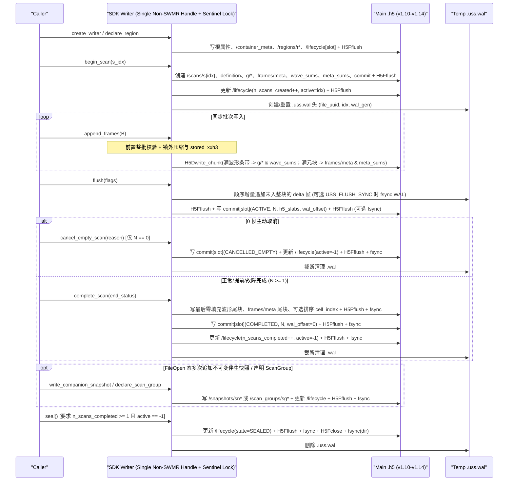

# HDF5 Wire Format 1.0 规范草案（M2 · r2）

状态：`1.0-draft r2`（依据 [ADR-0001～ADR-0021](decisions/README.md) 全面重构减痛，尚未冻结）；配套 [DATA_SPEC.md](DATA_SPEC.md) 与 [SDK_CONTRACT.md](SDK_CONTRACT.md)。本版落实 [ADR-0021](decisions/0021-hdf5-simplification-wal-push-only-and-ndt-fixes.md) 的全部架构收口：

- **去 SWMR + 外部临时 `.wal`**：Writer 全程维持单一非 SWMR HDF5 句柄，消除反复开关句柄与内嵌 `journal/` 永久死空间；
- **单一 `stored_xxh3` + `O(1)` 打开**：删除冗余 `decoded_xxh3` 与冷开 `O(N)` `sums_chain_xxh3`；
- **帧元大块解耦 + `CellCoord` 排序索引**：帧级定长元数据脱离波形 `F_chunk` 合并为大块，启用 `CellCoord` 时在 `complete_scan()` 写出不可变排序索引；
- **拼接、复检与超声领域修复**：新增轻量 `ScanGroup`、1..N Scan/多次追加/按层状态来源快照、`reinspection_targets[]` 含可选跨文件 `target_file_uuid`、最小解码核互操作纠偏及水浸/多探头 2D-TCG/TOFD PCS 可选物理表（ASTM E2339 / **E2663**）。

---

## 目录

1. [HDF5 底层配置、初始化硬规与全局约束](#hdf5-profile)
2. [容器识别、角色、版本解耦与能力位](#container-header)
3. [顶层 HDF5 层次结构总览](#hierarchy)
4. [双槽 `/lifecycle` 与 `/container_meta`](#lifecycle-and-meta)
5. [文件内轻量 M:N `Region` 与逻辑拼接组 `ScanGroup`](#regions)
6. [分模式 Scan `definition` Schema（SingleProbe 1.0 / PhasedArray 1.0）](#scan-schemas)
7. [原始波形、LSB-first 位图、三维分块与内置编解码](#waveforms-and-codecs)
8. [大块解耦帧元表（`frames/meta`）与 `CellCoord` 排序索引](#frame-columns)
9. [写入保护：外部 `.wal`、`wave_sums`/`meta_sums`、双槽 `commit` 与落盘协议](#map02-wire)
10. [统一快照模型与 Write-Once 版本化旁路派生容器](#snapshots-wire)
11. [锁外并发读、`LIF-02` 子进程隔离恢复与 `push` 暂存边界](#recovery-and-verify)
12. [标准最小样例 Wire 编码参考（Fixture H / Fixture P）](#worked-examples)

---

<a id="hdf5-profile"></a>
## 1. HDF5 底层配置、初始化硬规与全局约束

### 1.1 HDF5 属性列表（FCPL / FAPL / DCPL）与库初始化硬规

| 维度 | 必须设置的参数 / 调用 | 理由与约束 |
|---|---|---|
| **进程级初始化** | `H5dont_atexit()`、`H5PLset_loading_state(0)`、静态 `H5Zregister(32015/32004)`、`H5Eset_auto2(H5E_DEFAULT, NULL, NULL)` | 防止 Windows `.NET 4.8` 退出 `DllMain` Loader Lock 死锁、防止宿主机 `HDF5_PLUGIN_PATH` 劫持静态单库、禁 stderr 污染 |
| **FAPL**（`libver`） | `H5Pset_libver_bounds(fapl, H5F_LIBVER_V110, H5F_LIBVER_V114)` | HDF5 2.x 写出 v3 superblock 及 1.10–1.14 兼容对象；**严禁**传入 `H5F_LIBVER_LATEST` 或 `H5F_LIBVER_V200` |
| **FAPL**（块缓存） | `H5Pset_cache(fapl, 0, 0, 0, 0.0)`（`rdcc_nbytes = 0`） | 写端经 `H5Dwrite_chunk`、读端锁内查块偏移 + 锁外并发 `pread`/`ReadFile`，绕过 HDF5 块缓存（`CAP-01`） |
| **FCPL**（布局基线） | `H5Pset_userblock(fcpl, 0)`、`H5Pset_sizes(fcpl, 8, 8)`、`H5Pset_file_space_strategy(fcpl, H5F_FSPACE_STRATEGY_FSM_AGGR, false, 1)` | 固定 v3 superblock 位于偏移 `0` 且恒为 48 字节（`O=8, L=8`）；不使用 SWMR 模式 |
| **DCPL**（定长双槽记录） | 连续存储（`H5D_CONTIGUOUS`）+ `H5Pset_alloc_time(dcpl, H5D_ALLOC_TIME_EARLY)` + 写零初始化 | 适用于 `/lifecycle` 与 `commit`；确保槽位物理空间提前定址，更新槽不触发空间重分配 |
| **DCPL**（可扩展帧轴对象） | 分块存储（`H5D_CHUNKED`）+ `H5Pset_alloc_time(dcpl, H5D_ALLOC_TIME_INCR)` + `H5Pset_fill_time(dcpl, H5D_FILL_TIME_NEVER)` + 显式零 `fill_value` | 适用于 `samples`、`valid`、`frames/meta`、`wave_sums`、`meta_sums`；单 unlimited 维使用 HDF5 v1.10+ **Extensible Array（EA）** 索引 |

### 1.2 全局数据类型、字节序、校验和与单一真理源约定

1. **禁止变长与 2.0 专有类型**：全格式**严禁**使用 `H5T_VLEN`、`H5T_VARIABLE` 变长字符串、`H5T_REFERENCE` 与 HDF5 2.0 专有 `H5T_COMPLEX`。
2. **显式小端（Little-Endian）**：`format_major == 1` 固定全盘小端（`H5T_STD_*LE`、`H5T_IEEE_F32LE`、`H5T_IEEE_F64LE`）；唯一例外为上游标准 `H5Zlz4`（`32004`）的 12B/4B 大端块帧头（[§7.4](#codec-wire)）。
3. **紧凑自然对齐复合结构**：所有 `H5T_COMPOUND` 按本规范精确字节偏移构造，每个多字节成员自然对齐且总长为 8 字节倍数，所有 `reserved*` 字节恒置 `0`；**不提供运行时任意字段序 `CUSTOM_STRUCT`**（防未对齐 UB）。
4. **定长字符串编码**：全部定长字符串属性与结构字段采用 `H5T_STRING` + `H5T_CSET_UTF8` + `H5T_STR_NULLPAD`，定长 `L` 字节、尾部以 `0x00` 填充且不含内嵌 `NUL`。
5. **可变长 JSON 元数据**：`/container_meta`、`/regions/r*`、`/scan_groups/sg*`、`definition` 均存为一维连续 `H5T_STD_U8LE`（无 BOM 的 RFC 8259 UTF-8 JSON），避开 64 KiB HDF5 属性上限；校验和一律针对**磁盘原始字节序列**计算。解析器须拒绝重复键并施加合理字节/嵌套深度上限。
6. **唯一校验算法（`XXH3-64`）**：全格式所有 64 位校验和为标准无种子（`seed = 0`）`XXH3_64bits(bytes, len)`；空字节切片常量：
   ```text
   XXH3_EMPTY_64 = 0x2D06800538D394C2ULL
   ```
   物理数据块**仅存单一 `stored_xxh3`**（不再计算 `decoded_xxh3` 或冷开全量 `sums_chain_xxh3`）。
7. **单一真理源原则**：HDF5 属性仅保留 Layer-1 路由与校验必需字段；不在 JSON 内重复存储可由路径/属性/DCPL 唯一确定的冗余码（如删除 `mode_code`、路径冗余 `index`、固定 `endianness` 等）。
8. **单块上限与 `nvCOMP` 对齐**：单物理块未压缩与存储字节数均 `< 2^32`；启用 `shuffle_lz4` 时强制单块未压缩字节 `<= 0x40000000`（1 GiB，确保 `n_blocks == 1`）；推荐默认目标块 **1–4 MiB**（兼顾 M4 `nvCOMP` Zstd 硬件块上限与随机读延迟）。
9. **双槽取模统一规则**：全格式所有双槽记录（`/lifecycle` 与 `commit`）统一采用 `seq` 从 `1` 递增、槽位下标 **`slot = (seq - 1) % 2`**（即 `seq = 1 → slot 0`，`seq = 2 → slot 1`）。

---

<a id="container-header"></a>
## 2. 容器识别、角色、版本解耦与能力位

### 2.1 根组 `/` 不可变属性（文件创建时写入一次）

| 属性名 | HDF5 类型与形状 | 必填条件 | 精确语义 |
|---|---|---|---|
| `uss_magic` | `UTF-8 NULLPAD[8]`（标量） | 全部角色 | 固定 ASCII 8 字节 `"USS-HDF5"` |
| `format_major` | `H5T_STD_U16LE`（标量） | 全部角色 | 容器格式主版本；本规范为 `1` |
| `format_minor` | `H5T_STD_U16LE`（标量） | 全部角色 | 容器格式次版本；本规范为 `0` |
| `file_role` | `H5T_STD_U8LE`（标量） | 全部角色 | `1 = Acquisition`（主采集容器）；`2 = DerivedSnapshot`（Write-Once 旁路派生容器）；其余非法 |
| `file_uuid` | `H5T_STD_U8LE`，1D `[16]` | 全部角色 | SDK 分配的 RFC 9562 UUID（UUIDv4/UUIDv7）原始 16 字节，全生命周期不可变 |
| `required_features` | `H5T_STD_U64LE`（标量） | 全部角色 | **必要能力位掩码（`ID-02`）**；v1.0 基线恒为 `0`。读端遇任何不识别置位必须立即拒绝 |
| `optional_features` | `H5T_STD_U64LE`（标量） | 全部角色 | 可选可跳过提示位（`bit 0`: workpiece/run、`bit 1`: regions、`bit 2`: scan_groups、`bit 3`: companion_snapshots、`bit 4`: vendor_extensions） |
| `created_utc_ns` | `H5T_STD_I64LE`（标量） | 全部角色 | 创建 UTC Unix 纳秒时间戳（不可用写 `0`） |
| `writer_sdk_version` | `UTF-8 NULLPAD[32]`（标量） | 全部角色 | 信息性写入 SDK SemVer 字符串，**不参与兼容判定** |
| `source_file_uuid` | `H5T_STD_U8LE`，1D `[16]` | 仅 `file_role == 2` | 强绑定的主采集文件 `file_uuid`（可支持 1..N 个源 Scan，具体源 Scan 列表位于各快照 `definition.source_binding`） |

### 2.2 打开前置门禁

读取器按序检查：① `uss_magic == "USS-HDF5"`；② `format_major == 1`；③ `(required_features & ~SUPPORTED_REQUIRED_MASK) == 0`（v1.0 掩码为 `0`）；④ `file_role ∈ {1, 2}`（角色 `2` 必须含 `source_file_uuid`）。任一不满足立即返回稳定错误码拒绝；同 `format_major` 下高 `format_minor` 若 `required_features` 均支持，则安全忽略未知可选 JSON 键与未知 `optional_features` 位。

---

<a id="hierarchy"></a>
## 3. 顶层 HDF5 层次结构总览

### 3.1 `Acquisition` 主采集容器（`file_role = 1`）

```text
/                                   Group   [不可变根属性，§2.1]
├─ lifecycle                        Dataset [2]  连续存储 EARLY，packed LifecycleRecord（208B × 2，§4.1）
├─ container_meta                   Dataset [L]  连续 u8 UTF-8 JSON；attr: xxh3_64(u64)（§4.2）
├─ regions/                         Group   [可选：文件内轻量独立 Region，§5.1]
│   └─ r000000 .. r{R-1:06d}        Dataset [L]  连续 u8 UTF-8 JSON；attrs: region_id(UTF-8[64]), xxh3_64(u64)
├─ scan_groups/                     Group   [可选：多区域拼接/复检逻辑分组，§5.3]
│   └─ sg0000 .. sg{G-1:04d}        Dataset [L]  连续 u8 UTF-8 JSON；attrs: group_id(UTF-8[64]), xxh3_64(u64)
├─ scans/                           Group
│   └─ s000000 .. s{S-1:06d}/       Group   attrs: scan_id(UTF-8[64]), mode_type(u16),
│       │                                          schema_major(u16), schema_minor(u16), def_xxh3(u64)
│       ├─ definition               Dataset [L]  连续 u8 UTF-8 JSON（§6）
│       ├─ g/                       Group   [原始波形流组，§7]
│       │   └─ 0000 .. {Ng-1:04d}/  Group
│       │       ├─ samples          Dataset [E, K_g, S_g], max=[∞, K_g, S_g], chunks=[F_chunk, K_chunk_g, S_g],
│       │       │                           dtype=tau_g(LE), filter: none | (SHUFFLE,ZSTD) | (SHUFFLE,LZ4)
│       │       └─ valid            Dataset [E, ceil(K_g/8)], max=[∞, ceil(K_g/8)], chunks=[F_chunk, ceil(K_g/8)],
│       │                                   dtype=u8 (LSB-first packed bitset), filter: none
│       ├─ frames/                  Group   [大块解耦帧元表与可选 CellCoord 索引，§8]
│       │   ├─ meta                 Dataset [E], max=[∞], chunks=[F_meta_chunk], packed FrameMetaRow,
│       │   │                               filter: none | (SHUFFLE,ZSTD) | (SHUFFLE,LZ4)
│       │   └─ cell_index           Dataset [N_mapped], chunks=[16384], packed CellIndexEntry (24B)
│       │                                   [仅启用 CellCoord 时于 complete_scan() 写出]
│       ├─ wave_sums                Dataset [E_ws], max=[∞], chunks=[256], WaveSumsRow (16B × M_wave_chunks)
│       ├─ meta_sums                Dataset [E_ms], max=[∞], chunks=[256], ChunkSum (16B)
│       └─ commit                   Dataset [2]  连续存储 EARLY，packed CommitRecord（240B × 2，§9.3）
└─ snapshots/                       Group   [可选：FileOpen 态按 Scan 多次追加不可变伴生快照，§10]
    └─ sn0000 .. sn{M-1:04d}/       Group   attrs: snapshot_id(UTF-8[64]), schema_major(u16), schema_minor(u16), def_xxh3(u64)
        ├─ definition               Dataset [L]  连续 u8 UTF-8 JSON
        ├─ status                   Dataset [H,W] 或 [P]       u8（shared 模式），attr: xxh3_64
        ├─ source                   Dataset [H,W] 或 [P]       SnapshotSource(24B)（shared 模式），attr: xxh3_64
        ├─ coords                   Dataset [P, D]             f64LE 或 i32LE（仅 sparse），attr: xxh3_64
        ├─ layers/                  Group
        │   └─ <layer_name>         Dataset [H,W] 或 [P]       固定 LE 数值类型，attr: xxh3_64
        ├─ layer_status/            Group   [仅 status_mode == "per_layer"]
        │   └─ <layer_name>         Dataset [H,W] 或 [P]       u8，attr: xxh3_64
        └─ layer_source/            Group   [仅 source_mode == "per_layer"]
            └─ <layer_name>         Dataset [H,W] 或 [P]       SnapshotSource(24B)，attr: xxh3_64

[采集期间临时伴随文件，seal() 成功后删除]
<target_file>.uss.wal               外部顺序追加 WAL（§9.1）
```

### 3.2 `DerivedSnapshot` Write-Once 旁路派生容器（`file_role = 2`）

```text
/                                   Group   [根属性 + source_file_uuid[16]，§2.1]
├─ lifecycle                        Dataset [2]  同上双槽 LifecycleRecord（n_regions=0, n_scans_*=0, n_snapshots>=1）
├─ container_meta                   Dataset [L]  连续 u8 UTF-8 JSON（派生来源/工具与 VendorExtension）
└─ snapshots/                       Group   [1..M 个快照 sn0000..，与 §3.1 逐字节同构]
```

> 所有固定序号路径 0 基递增，禁止跳号；`<layer_name>` 限制为正则 `^[A-Za-z0-9._-]{1,64}$`。不再保留私有 `/blobs/` 子系统。

---

<a id="lifecycle-and-meta"></a>
## 4. 双槽 `/lifecycle` 与 `/container_meta`

### 4.1 `/lifecycle` 双槽复合记录（`[2]`，单槽 208 字节）

| 字节偏移 | 长度 | 字段名 | HDF5 磁盘类型 | 语义与不变量 |
|---:|---:|---|---|---|
| `0` | `8` | `seq` | `H5T_STD_U64LE` | 单调递增序号，从 `1` 起；槽位 `slot = (seq - 1) % 2`（`0` 表示未初始化） |
| `8` | `1` | `state` | `H5T_STD_U8LE` | `0 = OPEN`；`1 = SEALED`；`2 = SEALED_WITH_FAILURE` |
| `9` | `3` | `reserved0` | `H5T_ARRAY(U8LE, [3])` | 恒为 `0` |
| `12` | `4` | `n_regions` | `H5T_STD_U32LE` | 已提交的 `/regions/r*` 数量 |
| `16` | `4` | `n_scan_groups` | `H5T_STD_U32LE` | 已提交的 `/scan_groups/sg*` 数量 |
| `20` | `4` | `n_scans_created` | `H5T_STD_U32LE` | 已创建的 `/scans/s*` 槽总数（含已取消的空 Scan） |
| `24` | `4` | `n_scans_completed` | `H5T_STD_U32LE` | 已正常完成（`COMPLETED` 且 `N >= 1`）的 Scan 数量；`SEALED` 且 `file_role == 1` 时必须 `>= 1` |
| `28` | `4` | `active_scan_index` | `H5T_STD_I32LE` | 当前活动 Scan 序号；无活动 Scan 时为 `-1`；`SEALED` 时必须为 `-1` |
| `32` | `4` | `n_snapshots` | `H5T_STD_U32LE` | 已提交的 `/snapshots/sn*` 数量；`file_role == 2` 且 `SEALED` 时必须 `>= 1` |
| `36` | `4` | `failure_scan_index` | `H5T_STD_I32LE` | `SEALED_WITH_FAILURE` 时发生写失败的活动 Scan 序号（无则 `-1`） |
| `40` | `4` | `failure_error_code` | `H5T_STD_I32LE` | `SEALED_WITH_FAILURE` 对应 C ABI 错误码（正常为 `0`） |
| `44` | `4` | `reserved1` | `H5T_STD_U32LE` | 恒为 `0` |
| `48` | `8` | `failure_n_frames` | `H5T_STD_U64LE` | 故障时活动 Scan 已提交帧数参考值（权威以该 Scan `commit` 为准） |
| `56` | `8` | `container_meta_xxh3` | `H5T_STD_U64LE` | `/container_meta` 原始字节的 `XXH3-64` |
| `64` | `8` | `sealed_utc_ns` | `H5T_STD_I64LE` | 封存 UTC Unix 纳秒时间戳（`OPEN` 时为 `0`） |
| `72` | `128` | `failure_message` | `UTF-8 NULLPAD[128]` | 诊断性 UTF-8 截断描述（正常全 `0`） |
| `200` | `8` | `record_xxh3` | `H5T_STD_U64LE` | 前 200 字节（`[0..200)`）的 `XXH3-64` |

**权威槽裁决**：取 `seq >= 1` 且 `record_xxh3` 有效槽中 `seq` 最大者；若双槽均无效报硬损坏错误。

### 4.2 `/container_meta` JSON Schema（含跨文件续扫轻引线）

```json
{
  "producer": { "system_name": "UMS", "system_version": "2.4.0", "operator": null, "notes": null },
  "workpiece": { "workpiece_id": "WP-2026-001", "name": "Ti-6Al-4V Wing Spar", "part_number": "PN-8841", "serial_number": "SN-0042", "material": "Ti-6Al-4V" },
  "run": { "run_id": "RUN-20261128-01", "label": "Initial UT Inspection" },
  "continuation_of_file_uuid": null,
  "crs_transforms": [
    {
      "from_crs": "probe_local_mm",
      "to_crs": "scanner_flange_mm",
      "matrix_4x4_row_major": [1,0,0,0, 0,1,0,0, 0,0,1,25.0, 0,0,0,1],
      "description": "TCP to probe reference origin"
    }
  ],
  "vendor_extensions": []
}
```

- `workpiece`、`run`、`continuation_of_file_uuid`（大工件中途停机/换探头后新开文件接续原文件的可选 RFC 9562 UUID 字符串，纯元数据引线，不触发跨文件解析）与 `crs_transforms`（容器级坐标系刚体变换链，行优先 4×4 齐次矩阵，$p_{\text{to}} = M \cdot p_{\text{from}}$，打通 `PA-01`/`R-13` 3D 坐标自解释）均可缺省或为 `null`。

---

<a id="regions"></a>
## 5. 文件内轻量 M:N `Region` 与逻辑拼接组 `ScanGroup`

### 5.1 文件内轻量 `Region`（`/regions/r{i:06d}`，`D-11`）

在 `FileOpen` 态通过 `declare_region` 写为不可变连续 `u8` JSON，附属性 `region_id (UTF-8[64])`、`xxh3_64 (u64)`（不建树形父子环检测，保持极简）：

```json
{
  "region_id": "REG-ZONE-A1",
  "name": "Zone A1 Web Section",
  "description": null,
  "crs_ref": "workpiece_cad_mm",
  "bounds": { "dims": 3, "unit": "mm", "min": [0.0, 0.0, 0.0], "max": [250.0, 120.0, 18.0] },
  "vendor_extensions": []
}
```

- `region_id` 非空且文件内唯一；`Scan.definition.region_refs[]` 与 `Region` 为 M:N 引用，拒绝悬空引用；未采集的已声明 `Region` 合法留空。

### 5.2 多目标复检与跨文件轻引线（`Scan.definition.reinspection_targets[]`）

取代原单对象 `reinspection_of`，支持一次精扫复检横跨拼接扫描中多个原 Scan，并可选携带跨文件 `target_file_uuid`（纯元数据引线，Core 不做跨文件引擎）：

```json
{
  "reinspection_targets": [
    {
      "target_file_uuid": null,
      "target_scan_id": "SCAN-0001",
      "target_scan_index": 0,
      "target_region_id": "REG-ZONE-A1",
      "reason": "seam_indication_rescan"
    }
  ]
}
```

- 当 `target_file_uuid == null`（文件内复检）：`target_scan_index` 须严格 `< 当前 scan_index` 且与对应 `scan_id` 一致；若填写 `target_region_id` 须已存在于 `/regions/`。
- 当 `target_file_uuid != null`（跨文件复检引线）：不要求目标 Scan 在当前文件存在（`target_scan_index` 可为 `null`），供上层系统与外部分析追溯原文件身份。

### 5.3 多区域拼接逻辑组（`/scan_groups/sg{k:04d}`）

用于在“底层各 Scan 严格独立、不强行融合原始波形”的前提下，显式声明哪几个 Scan 共同构成一个**多区域拼接检测整体**（与独立复检/标定验证 Scan 清晰区分）：

```json
{
  "group_id": "WHOLE-SPAR-INSPECTION",
  "name": "Wing Spar Full Stitched Inspection",
  "role": "stitched_composite",
  "crs_ref": "workpiece_cad_mm",
  "region_refs": ["REG-ZONE-A1", "REG-ZONE-A2", "REG-ZONE-A3"],
  "members": [
    { "scan_index": 0, "scan_id": "SCAN-0001", "member_role": "primary" },
    { "scan_index": 1, "scan_id": "SCAN-0002", "member_role": "primary" },
    { "scan_index": 2, "scan_id": "SCAN-0003", "member_role": "primary" }
  ],
  "vendor_extensions": []
}
```

- `role ∈ {"stitched_composite", "reinspection_set", "multi_pass_set", "custom"}`；在 `FileOpen` 态于所引 Scan 均已创建（或完成）后声明并更新 `/lifecycle.n_scan_groups`。

---

<a id="scan-schemas"></a>
## 6. 分模式 Scan `definition` Schema（`SingleProbe 1.0` / `PhasedArray 1.0`）

> 跨 ABI 分层原则（[ADR-0021](decisions/0021-hdf5-simplification-wal-push-only-and-ndt-fixes.md)）：**最小解码必填核**在 `uss.h` 中由强类型 C11 结构体传入并强校验；**DICONDE（ASTM E2339 / E2663）& NeXus 可选物理表**与 **`VendorExtension`** 以 UTF-8 JSON（配机读 JSON Schema）传入，v0.x 阶段对可选物理表实行宽容校验（允许未知可选键），待 `D-09` 实机核对后随 `1.0` 冻结。

### 6.1 Scan 组属性与模式类型枚举

`/scans/s{scan_index:06d}` 不可变属性：`scan_id (UTF-8[64])`、`mode_type (u16)`、`schema_major (u16)`、`schema_minor (u16)`、`def_xxh3 (u64)`。
- `mode_type` 枚举：`1 = SingleProbe`（Core v1，`schema 1.0`）、`2 = PhasedArray`（Core v1，`schema 1.0`）；预留：`3 = FMC`、`4 = FeatureOnly`（Core v1 拒绝）。
- `retention_mode`：Core v1 固定为 `"full_wave"`（`wave_and_feature` 与 `feature_only` 归 M4 统一设计）。

### 6.2 `SignalDescriptor` 必填核（消除全部互操作歧义）

每个 `groups[g]`（`group_index`, `name`, `data_level ∈ {"single_element", "synthesized_beam"}`, `k_count`, `k_chunk`, `codec`, `codec_params`, `signal_descriptor`, `streams[]`）的 `signal_descriptor` 明确物理换算契约：

| 字段 | 必填 | 类型与精确语义 |
|---|---|---|
| `dtype` | 是 | `"i8"\|"u8"\|"i16"\|"u16"\|"i32"\|"u32"\|"f32"`（拒 `f64` 与复数） |
| `adc_effective_bits` | 是 | `u8`（整型 `1..32`；`f32` 物理量写 `0`） |
| `adc_bit_alignment` | 是 | `"lsb"` \| `"msb"` \| `"none"`（`f32` 为 `"none"`）。**确定换算顺序**：当为 `"msb"` 且 `adc_effective_bits < container_bits` 时，读端**先**按 `shift = container_bits - adc_effective_bits` 右移丢弃低位无效/标志位（若 `adc_signed` 则算术右移，否则逻辑右移），得到对齐后的原始码 `raw_aligned`，**再**代入标度公式与饱和比较；当为 `"lsb"` 且 `adc_signed == true` 时，按 `adc_effective_bits` 做二补码符号扩展（若未扩展） |
| `adc_signed` | 是 | `bool` |
| `amplitude_scale_mode` | 是 | `"linear"`（`phys = (raw_aligned - raw_zero_offset) * amplitude_scale`）或 `"log_db"`（`phys_db = (raw_aligned - raw_zero_offset) * amplitude_scale + ref_db`，必填 `ref_db` 与 `full_scale_raw`） |
| `raw_zero_offset` | 是 | `f64`（基于 `raw_aligned`） |
| `amplitude_scale` | 是 | `f64`（非零；允许负值表达反相通道） |
| `ref_db` / `full_scale_raw` | 否 | `f64 | null`（`log_db` 必填 `ref_db`；提供 `full_scale_raw` 时支撑原始码与 `%FSH` 互转） |
| `amplitude_unit` | 是 | `string`（`"percent_fsh"`, `"volt"`, `"raw_counts"`, `"dB"` 等） |
| `saturation_min_val` / `saturation_max_val` | 否 | `f64 | null`（基于 `raw_aligned` 或 `f32` 值域，同时支持整型与浮点饱和判据） |
| `signal_representation` | 是 | `"raw_rf"` \| `"rectified_full"` \| `"rectified_pos"` \| `"rectified_neg_positive"`（负半周取正幅值） \| `"rectified_neg_signed"`（保留负号） \| `"analytic_envelope"` \| `"log_db"` |
| `sample_count` (`S_g`) | 是 | `u32`（`>= 1`） |
| `sample_interval_ns` | 是 | `f64`（`> 0`，保存波形相邻样点时间步长，单位 ns） |
| `adc_sample_rate_hz` | 否 | `u64 | null`（ADC 原始整数采样率；当硬件开启峰值保持/抽取压缩使 `sample_interval_ns > 1e9/adc_sample_rate_hz` 时必填，并配 `compression_mode ∈ {"none","decimation","peak_hold","min_max"}`） |
| `start_delay_ns` | 是 | `f64`（相对 `time_zero_ref` 的默认起点延迟，ns） |
| `time_zero_ref` | 是 | `"trigger"` \| `"surface_interface"` \| `"wedge_exit"` \| `"calibrated_zero"`（若选 `"surface_interface"`，建议在帧元启用 `interface_tof_ns` 保留逐帧水程/表面距离） |

### 6.3 `SingleProbe 1.0` 与 `PhasedArray 1.0` 必填核及可选物理表（ASTM E2339 / E2663）

1. **`SingleProbe 1.0`（`mode_type = 1`）必填核**：
   - `probes[]`：`[{probe_id, name}]`；`events[]`：`[{event_id, tx_probe_id, tx_channel_id}]`；
   - `groups[g].data_level == "single_element"`，`streams[q]`：`{stream_id, local_index (==q), event_id, rx_probe_id, rx_channel_id, start_delay_ns_override?, gain_db_override?, gain_override_mode? ("absolute"|"delta")}`。
2. **`PhasedArray 1.0`（`mode_type = 2`）必填核**：
   - `array_probes[]`：`[{probe_id, name, element_count, topology: "linear_1d"|"matrix_2d"|"annular"|"custom", origin_convention: "element_0_center"|"array_center", pitch_mm?, pitch_secondary_mm?, n_primary?, n_secondary?, matrix_order?: "row_major"|"col_major"|"serpentine", annular_radii_mm?: [{inner_mm, outer_mm}], element_positions_mm?: f64[N][3]}]`（`linear_1d` 必填 `pitch_mm`；`matrix_2d` 必填 `n_primary/n_secondary/pitch_mm/pitch_secondary_mm`；`annular` 必填 `annular_radii_mm`；`custom` 必填 `element_positions_mm`）；
   - `focal_laws[]`：每条法则**分离发射与接收探头以原生支持 DMA/DLA 双阵与 Pitch-Catch PAUT**：
     `{law_id, law_index, tx_probe_id, rx_probe_id, tx_elements[], tx_delays_ns[], rx_elements[], rx_delays_ns[], tx_apodization?, rx_apodization?, wedge_delay_ns?, refracted_angle_deg?, skew_angle_deg?, focal_type?: "true_depth"|"half_path"|"projection"|"unfocused"|"ddf", focal_depth_mm?, wave_mode?: "L"|"T"|"LL"|"TT"|"LT"|"TL"}`；
   - `events[]`：`[{event_id, tx_focal_law_id}]`（`streams[q]` 持 `rx_focal_law_id` 支持单发多收并行波束合成；常规 PA 两者相同）；
   - `groups[g].streams[q]`：`{stream_id, beam_id, local_index (==q), event_id, rx_focal_law_id, rx_output_kind: "beamformed_sum"|"single_element_raw", start_delay_ns_override?, gain_db_override?, gain_override_mode?, exit_point_offset_mm?, exit_point_crs?}`。
   - **PA 唯一帧位置（`PA-01`）**：同帧全部声束共享 `frames/meta` 的唯一帧位置；高速扫查可于可选物理表记录 `law_prf_hz` 与 `frame_rate_hz` 供离线运动偏斜补偿。
3. **可选物理表 `mode_schema.physics`（ASTM E2339 / E2663 + NeXus，v0.x 宽容演进 JSON）**：
   - **`coupling`（支持 UMS 水浸/喷水与接触式）**：`coupling_mode ∈ {"contact","immersion","squirter","wheel","air_coupled"}`、`couplant`、`water_velocity_m_s`、`water_temperature_c`、`nominal_water_path_mm`；
   - **`probe_specs[probe_id]`**：厂商/型号/序列号、中心频率、-6 dB 带宽、晶片尺寸/水浸聚焦曲率/焦距、双晶隔声层/屋顶角、`disabled_elements[]`（PA 坏阵元）；
   - **`wedges[probe_id]`（按探头索引，支持多组/双探头）**：型号、材质、声速、入射/折射角、首阵元高度与偏置、屋顶角；
   - **`tofd_or_pitch_catch`（按组/事件可选）**：`pcs_mm`（探头中心距）、收发相对 6-DOF 变换；
   - **`pulser_receiver[group_index | law_id]`（支持多组并发 S+L 扫与逐法则 2D-TCG）**：发射电压、脉宽、`law_prf_hz`/`frame_rate_hz`、**增益三分解**（`reference_gain_db`、`scan_gain_offset_db`、`transfer_correction_db`）、`hardware_reject_percent`、模拟滤波、硬件平均、`tcg_curve`（明确 `time_ref ∈ {"trigger","surface_interface","wedge_exit"}` 与插值规则）、`dac_curve`；
   - **`specimen_and_calibration`**：材料、纵/横波声速、`nominal_thickness_mm`、温度、衰减、`calibration_block_ref`（试块/反射体/校准时间）。
4. **轻量参数化曲面几何（`surface_geometry`）**：`type ∈ {"plane","cylinder","sphere","cone","torus","external_ref"}`（增补管件弯头 `torus`、可选 `nominal_thickness_mm`、`external_ref` 带 `content_xxh3` 防外部 CAD 漂移；`pose_matrix_4x4` 明确为**行优先** `T_to<-from`；**严禁嵌点云/三角网格**）。
5. **`VendorExtension` 信封**：`{vendor_id, schema_uri, schema_version, payload}`（纯 JSON 对象；删去 `/blobs/` 私有二进制文件系统）。

---

<a id="waveforms-and-codecs"></a>
## 7. 原始波形、LSB-first 位图、三维分块与内置编解码

1. **`samples`**：`/scans/sNNNNNN/g/{g:04d}/samples`，形状 `[E, K_g, S_g]`，`maxshape = [H5S_UNLIMITED, K_g, S_g]`，`chunks = [F_chunk, K_chunk_g, S_g]`，支持 `dtype ∈ {i8, u8, i16, u16, i32, u32, f32}`（显式小端，`f32` 按 IEEE-754 逐位无损保真）。
2. **边缘块零填充**：第 `c` 帧条带的第 `j` 个 K 块偏移为 `(c * F_chunk, j * K_chunk_g, 0)`（$0 \le j < C_{k,g} = \lceil K_g / K_{\text{chunk},g} \rceil$）；未压缩块缓冲恒为完整三维形状，超出 `N`、超出 `K_g` 及 `valid == 0` 的槽位全部填 `0x00` 字节。条带未压缩总字节应保持合理有界（与 `staging_budget` 匹配）。
3. **`valid`（LSB-first packed bitset）**：`/scans/sNNNNNN/g/{g:04d}/valid`，形状 `[E, ceil(K_g/8)]`，`chunks = [F_chunk, ceil(K_g/8)]`，`H5T_STD_U8LE`，`filter = none`；`valid(n, q) = (bytes[n, q>>3] >> (q&7)) & 1`，高尾部位强制清零并校验。

<a id="codec-wire"></a>
### 7.4 三条内置无损编码链（`none` / `shuffle_zstd` / `shuffle_lz4`）

| Codec | HDF5 DCPL 声明（按写入顺序） | 磁盘存储字节（`H5Dwrite_chunk`）精确格式 |
|---|---|---|
| **`none`** | 无 filter | 原始小端未压缩块字节 |
| **`shuffle_zstd`** *(默认)* | 1. `H5Z_FILTER_SHUFFLE`（ID `2`，`H5Z_FLAG_MANDATORY`，`cd_values = [elem_size]`）<br>2. `H5Z_FILTER_ZSTD`（ID `32015`，`H5Z_FLAG_MANDATORY`，`cd_values = [level]`，默认 `3`，推荐 `1..9` 兼顾 M4 `nvCOMP`） | Byte-shuffle（`elem_size == 1` 为恒等）→ 单帧 RFC 8878 Zstd（`ZSTD_compress`，帧头携带精确 `Frame_Content_Size == raw_chunk_bytes`） |
| **`shuffle_lz4`** | 1. `H5Z_FILTER_SHUFFLE`（ID `2`，`H5Z_FLAG_MANDATORY`，`cd_values = [elem_size]`）<br>2. `H5Z_FILTER_LZ4`（ID `32004`，`H5Z_FLAG_MANDATORY`，`cd_values = [0x40000000]`） | Byte-shuffle → 标准 `H5Zlz4` 封装（单块强约束 `raw_chunk_bytes <= 1 GiB`）：`be64(orig_size)` + `be32(orig_size)` + `be32(c_len)` + `payload[c_len]`（若 `c_len == orig_size` 存原始字节，否则 raw LZ4 block） |

---

<a id="frame-columns"></a>
## 8. 大块解耦帧元表（`frames/meta`）与 `CellCoord` 排序索引

### 8.1 大块解耦原则（彻底消除微块碎裂）

帧级定长元数据**不再**为每个 1B 标志列建独立数据集，也不再与波形共享小 `F_chunk`（如 `8` 帧）：
- 全部帧级定长字段按**降序自然对齐（`8B → 4B → 2B → 1B`）+ 尾部显式零填充至 8 字节倍数**，静态编译为一个紧凑 `H5T_COMPOUND` 行类型 `FrameMetaRow`，存入单一数据集 `/scans/sNNNNNN/frames/meta`；
- 独立分块尺寸 `F_meta_chunk`（默认 `8192` 帧/块，可配 `1024..65536`；默认可开启 `shuffle_zstd` 或 `none`），400,000 帧（100 GB 文件）仅约 **49 个块**，彻底消除 300% 校验膨胀与随机寻道。

### 8.2 `FrameMetaRow` 字段组成规则

按 `definition` 启用项动态决定包含哪些成员（均按 `8B → 4B → 2B → 1B` 确定性排序，同名顺序按声明序）：
1. **位置字段（仅 `position.mode != "NONE"`，支持 5 种内置模式，已取消 `CUSTOM_STRUCT`）**：
   - `"ENCODER_I64"`：`pos_enc: i64[n_axes]`（`1 <= n_axes <= 8`）+ **`pos_axis_valid_mask: u8`**（第 `a` 位表第 `a` 轴有效，解决 A 轴有效 B 轴未接全 0 的实测场景！）；`definition.position.encoder_axes[a]` 明确公式 **`phys = (raw - zero_offset_counts) / counts_per_unit`** 及可选 `wrap_period_units`（旋转周期轴）；
   - `"CARTESIAN_2D_F64"`：`pos_x, pos_y: f64`；
   - `"CARTESIAN_3D_F64"`：`pos_x, pos_y, pos_z: f64`；
   - `"POSE_6D_EULER_F64"`：`pos_x, pos_y, pos_z, pos_r0, pos_r1, pos_r2: f64`；`definition.position` **强制声明** `euler_order`、`rotation_type: "intrinsic"|"extrinsic"`、`transform_direction: "tool_in_base"|"base_in_tool"`、`angle_unit: "deg"|"rad"`（`r0,r1,r2` 按 `euler_order` 顺序对应第 1/2/3 次旋转）；
   - `"POSE_6D_QUAT_F64"`：`pos_x, pos_y, pos_z, pos_qx, pos_qy, pos_qz, pos_qw: f64`（强制声明 `transform_direction`）；
   - 所有非 `NONE` 模式均含 `pos_valid: u8`（`0` = 整帧位置无效且位置字段全 `0x00`，`1` = 有效；禁用 `NaN` 猜无效）。
2. **同步等级与可选界面波声时**：
   - `sync_level: u8`（仅 `per_frame_sync_level == true` 时包含，`0=UNAVAILABLE, 1=HARDWARE_SYNCHRONIZED, 2=STEP_AND_SHOOT_VERIFIED, 3=SOFTWARE_TIMESTAMP_PAIRED`）；
   - `interface_tof_ns: f32` 或 `f64`（可选，水浸 `time_zero_ref == "surface_interface"` 时保留逐帧表面水程声时）。
3. **可选 `CellCoord[Frame]`**（`definition.cell_coord` 含 `enabled`, `dims ∈ {1,2,3}`, `axis_names`, `origin?`, `step?`, `unit?`, `crs_ref?`, `grid_shape_hint?`）：
   - `cell_coord: i32[dims]` + `cell_valid: u8`（`0` = 转场/无网格归属且 `cell_coord` 置 `0`，`1` = 有效归属）。
4. **固定附加列（`definition.aux_columns[]`）**：
   - 支持 `dtype ∈ {i8..u64, f32, f64}`、`components ∈ [1, 16]`、`nullable: bool`；
   - `semantic_role ∈ {"timestamp_utc_ns", "timestamp_mono_ns", "source_trigger_id", "nominal_position", "scan_velocity", "region_index", "pass_index", "scan_direction", "custom"}`（直接支持同 Scan 跨区域、多遍重复扫查与往返方向自解释）；
   - 所有 `nullable == true` 的列合并打包至位掩码 `aux_valid_mask: u8[ceil(N_nullable/8)]`（LSB-first，高尾部位清零校验），空值对应数据槽零填充。

### 8.3 `CellCoord` 不可变排序索引（`/scans/sNNNNNN/frames/cell_index`）

仅当 `cell_coord.enabled == true` 且存在至少 1 个 `cell_valid == 1` 帧时，在 `complete_scan()` 收尾阶段写出（外部归并/分桶排序保证 `CAP-01` 有界内存）：
- 形状 `[N_mapped]`，分块 `[16384]`（可 `shuffle_zstd` 或 `none`），按 `(c0, c1, c2, frame_idx)` 字典升序排列；
- **`CellIndexEntry`（24 字节，8 字节对齐）**：`0..3: c0 (i32)`、`4..7: c1 (i32, 缺省 0)`、`8..11: c2 (i32, 缺省 0)`、`12..15: reserved (u32=0)`、`16..23: frame_idx (u64)`；
- `CommitRecord` 记录 `cell_index_count` 与 `cell_index_xxh3`。读取方经二分查找在 **`O(log N)`** 时间内（百 GB 文件约 3–5 次块读，<1 ms）返回落在该格的全部 `0..M` 帧号，不违背 `CAP-01`。

---

<a id="map02-wire"></a>
## 9. 写入保护：外部 `.wal`、`wave_sums`/`meta_sums`、双槽 `commit` 与落盘协议

### 9.1 外部临时顺序追加 WAL（`<target_file>.uss.wal`）

彻底取代旧版内嵌 `journal/`，消除永久死空间、Flush 重写放大与 `K_chunk` 组合爆炸：

1. **WAL 文件头（64 字节，小端，8 字节对齐）**：

| 偏移 | 长度 | 字段 | 类型 | 说明 |
|---:|---:|---|---|---|
| `0` | `8` | `magic` | `ASCII[8]` | 固定 `"USS-WAL1"` |
| `8` | `16` | `file_uuid` | `u8[16]` | 须与主 `.h5` 根 `file_uuid` 严格一致 |
| `24` | `4` | `scan_index` | `u32` | 当前活动 Scan 序号 |
| `28` | `4` | `reserved0` | `u32` | 恒为 `0` |
| `32` | `8` | `wal_generation` | `u64` | 单调递增代号，绑定至 `CommitRecord.wal_generation` |
| `40` | `8` | `def_xxh3` | `u64` | 匹配当前 Scan `definition` 的 `XXH3-64` |
| `48` | `8` | `reserved1` | `u64` | 恒为 `0` |
| `56` | `8` | `header_xxh3` | `u64` | 前 56 字节的 `XXH3-64` |

2. **增量追加记录（从偏移 `64` 起顺序追加，每次 `flush()` 仅追加自上次 Flush 以来尚未落入 `.h5` 整块的增量帧）**：
   - **`WalRecordHeader`（40 字节，8 字节对齐）**：
     - `0..3`: `record_magic (u32 = 0x31524C57 "WLR1")`
     - `4..7`: `record_type (u32: 1 = FRAME_BATCH_DELTA)`
     - `8..15`: `start_frame_idx (u64)`
     - `16..23`: `frame_count (u64 >= 1)`
     - `24..31`: `payload_len (u64)`
     - `32..39`: `record_xxh3 (u64)`（覆盖 `WalRecordHeader[0..32) || payload[0..payload_len)`）
   - **`payload`**：规范顺序拼接未压缩小端字节：`[g=0..G-1: samples(frame_count, K_g, S_g) || valid(frame_count, ceil(K_g/8))] || FrameMetaRow[frame_count]`。
   - **回收**：`complete_scan()` 将最后尾块写入 `.h5` 并完成 `fsync` 提交后截断重置 `.wal`；`seal()` / `seal_with_failure()` 完成后删除 `.wal`（主文件 **0 字节永久日志死空间**）。

### 9.2 逐块校验表：`wave_sums` 与 `meta_sums`（单一 `stored_xxh3`）

- **`ChunkSum`（16 字节，8 字节对齐）**：`0..3: stored_len (u32)`、`4..7: filter_mask (u32, 恒 0)`、`8..15: stored_xxh3 (u64)`。
- `/scans/sNNNNNN/wave_sums`：`[E_ws]`，分块 `[256]`，每行 `WaveSumsRow` 为 `H5T_ARRAY(ChunkSum, [M_wave_chunks])`，其中 $M_{\text{wave\_chunks}} = \sum_{g=0}^{G-1}(\lceil K_g/K_{\text{chunk},g}\rceil + 1)$，按 `g = 0..G-1` 的 `samples`（`k_tile = 0..C_{k,g}-1`）接 `valid` 顺序排列。
- `/scans/sNNNNNN/meta_sums`：`[E_ms]`，分块 `[256]`，每行 1 个 `ChunkSum`（16B），对应 `frames/meta` 的每个 `F_meta_chunk` 物理块。

### 9.3 双槽提交记录 `/scans/sNNNNNN/commit`（`[2]`，固定 240 字节/槽）

| 字节偏移 | 长度 | 字段名 | HDF5 磁盘类型 | 语义与不变量 |
|---:|---:|---|---|---|
| `0` | `8` | `seq` | `H5T_STD_U64LE` | 单调递增序号，从 `1` 起；`slot = (seq - 1) % 2` |
| `8` | `1` | `scan_storage_state` | `H5T_STD_U8LE` | `0 = ACTIVE`；`1 = COMPLETED`；`2 = CANCELLED_EMPTY`（由 `cancel_empty_scan()` 写入，`N == 0`） |
| `9` | `1` | `end_status` | `H5T_STD_U8LE` | `0 = IN_PROGRESS`；`1 = NORMAL_COMPLETE`；`2 = USER_EARLY_STOP`；`3 = FAULT_ABORTED`；`4 = CANCELLED_EMPTY` |
| `10` | `2` | `reserved0` | `H5T_ARRAY(U8LE, [2])` | 恒为 `0` |
| `12` | `4` | `end_reason_code` | `H5T_STD_I32LE` | 结束/故障原因码（正常 `0`） |
| `16` | `8` | `n_frames` | `H5T_STD_U64LE` | 权威可见帧数 `N`（`COMPLETED` 必须 `>= 1`；`CANCELLED_EMPTY` 必须 `== 0`） |
| `24` | `8` | `h5_wave_slabs` | `H5T_STD_U64LE` | 已落盘至 `.h5` 主数据集的波形条带数（`COMPLETED` 时为 `ceil(N / F_chunk)`） |
| `32` | `8` | `h5_meta_chunks` | `H5T_STD_U64LE` | 已落盘至 `.h5` `frames/meta` 的大块数（`COMPLETED` 时为 `ceil(N / F_meta_chunk)`） |
| `40` | `8` | `wal_committed_offset` | `H5T_STD_U64LE` | `.wal` 已提交尾帧覆盖到的字节偏移（`COMPLETED`/`CANCELLED_EMPTY` 为 `0`） |
| `48` | `8` | `wal_generation` | `H5T_STD_U64LE` | 对应 `.wal` 文件头代号（`COMPLETED`/`CANCELLED_EMPTY` 为 `0`） |
| `56` | `8` | `def_xxh3` | `H5T_STD_U64LE` | `definition` 原始字节的 `XXH3-64` |
| `64` | `8` | `cell_index_count` | `H5T_STD_U64LE` | `frames/cell_index` 行数（未启用或 `ACTIVE` 时为 `0`） |
| `72` | `8` | `cell_index_xxh3` | `H5T_STD_U64LE` | `frames/cell_index` 原始字节的 `XXH3-64`（空时为 `XXH3_EMPTY_64`） |
| `80` | `8` | `commit_utc_ns` | `H5T_STD_I64LE` | 提交 UTC Unix 纳秒时间戳 |
| `88` | `8` | `reserved1` | `H5T_STD_U64LE` | 恒为 `0` |
| `96` | `128` | `end_reason_message` | `UTF-8 NULLPAD[128]` | 诊断性文本（空时全 `0`） |
| `224` | `8` | `reserved2` | `H5T_STD_U64LE` | 恒为 `0` |
| `232` | `8` | `record_xxh3` | `H5T_STD_U64LE` | 前 232 字节（`[0..232)`）的 `XXH3-64` |

### 9.4 非 SWMR + 外部 `.wal` 写入、取消空 Scan 与低频 `fsync` 落盘协议



**关键防线**：
1. **`complete_scan` 与 `/lifecycle` 一致性裁决**：恢复或读取时若某 Scan 的 `commit` 已为 `COMPLETED`（或 `CANCELLED_EMPTY`）而 `/lifecycle.active_scan_index` 尚未归 `-1`，**以该 Scan 的权威 `commit` 为准**，绝不把已完成 Scan 降级回 `ACTIVE`。
2. **`seal_with_failure` 严格语义**：仅当 `n_scans_completed >= 1` 或当前活动 Scan 已有已提交/已 Flush 帧时允许调用（禁止封存 0-Scan 空壳）；**绝不**向已报错的 HDF5 句柄补写未 Flush 的内存尾部，仅保全此前已提交/已 Flush 的完好范围并尝试写入 `/lifecycle(SEALED_WITH_FAILURE)` + `fsync` + `H5Fclose`。若写入 `/lifecycle` 再次失败，直接关闭并交由 `LIF-02` 独立恢复子进程处理。

---

<a id="snapshots-wire"></a>
## 10. 统一快照模型与 Write-Once 版本化旁路派生容器

### 10.1 多 Scan 绑定与按层独立状态/来源（`SNAP-01` / `ADR-0014` / `ADR-0021`）

`/snapshots/sn{j:04d}` 可在 `Acquisition` 封存前的 `FileOpen` 态**按 Scan 多次不可变追加**（无需等全 Run 结束），也可写入独立的 `DerivedSnapshot`（`file_role = 2`）容器。`definition` JSON：

```json
{
  "snapshot_id": "CSCAN-WHOLE-SPAR-G1G2",
  "title": "Whole Spar Gate1 Peak & Gate2 Backwall",
  "origin_kind": "acquisition_companion",
  "source_binding": {
    "source_file_uuid": "01936a1b-2c3d-7e4f-8a5b-6c7d8e9f0a1b",
    "scan_group_id": "WHOLE-SPAR-INSPECTION",
    "source_scans": [
      { "scan_index": 0, "scan_id": "SCAN-0001" },
      { "scan_index": 1, "scan_id": "SCAN-0002" }
    ],
    "region_refs": ["REG-ZONE-A1", "REG-ZONE-A2"]
  },
  "parameter_provenance": {
    "params_kind": "actual_snapshot_params",
    "params_changed_during_acquisition": false,
    "params_history_complete": true,
    "gate_param_segments": [],
    "algorithm_params": { "gate_name": "Gate1", "start_ns": 1200.0, "width_ns": 4500.0, "threshold_percent_fsh": 20.0 }
  },
  "status_mode": "per_layer",
  "source_mode": "shared",
  "layout": {
    "layout_type": "regular_grid_2d",
    "height": 200,
    "width": 500,
    "axis_0": { "name": "index_y", "origin": 0.0, "step": 1.0, "unit": "mm" },
    "axis_1": { "name": "scan_x",  "origin": 0.0, "step": 0.5, "unit": "mm" },
    "crs_ref": "workpiece_cad_mm"
  },
  "layers": [
    { "name": "gate1_amp", "dtype": "f32", "unit": "percent_fsh", "quantity_kind": "peak_amplitude", "codec": "shuffle_zstd" },
    { "name": "gate2_bw",  "dtype": "f32", "unit": "percent_fsh", "quantity_kind": "backwall_amplitude", "codec": "shuffle_zstd" }
  ],
  "vendor_extensions": []
}
```

- **存储与压缩统一规则（修复原 `<=4 MiB` 冲突）**：当层 `codec != "none"` 时一律使用分块存储（2D `[min(H,256), min(W,256)]`，1D `[min(P,65536)]`）；仅当 `codec == "none"` 时使用连续存储。每个层、`status`、`source`、`coords` 均附 `xxh3_64 (u64)` 属性。
- **`status_mode` 与 `source_mode`**：支持 `"shared"`（整快照共用 `status`/`source`）与 `"per_layer"`（各层独立 `layer_status/<layer_name>` / `layer_source/<layer_name>`），原生满足多闸门各自独立 `VALID` vs `NOT_DETECTED` 与多回波/复合角不同来源追溯（`ADR-0014`）。
- **`PointStatus`（`u8`）**：`0 = UNPOPULATED`、`1 = VALID`（含有效零值）、`2 = NOT_DETECTED`、`3 = INPUT_INVALID`、`4 = INPUT_NOT_RETAINED`、`5 = POSITION_INVALID`；非 `VALID` 数值占位写 `0`。
- **`SnapshotSource`（24 字节，8 字节对齐）**：
  - `0..7`: `frame_idx (u64)`（无来源 `0xFFFFFFFFFFFFFFFF`）
  - `8..11`: `scan_index (u32)`（无来源 `0xFFFFFFFF`）
  - `12..15`: `stream_local_index (u32)`（组内 `q` 下标，无来源 `0xFFFFFFFF`）
  - `16..17`: `group_index (u16)`（无来源 `0xFFFF`）
  - `18..19`: `source_flags (u16)`（`bit 0`: 来源波形存在且可追溯、`bit 1`: 多候选经策略选出、`bit 2`: 多来源合成/平均［此为代表主来源］）
  - `20..23`: `reserved (u32 = 0)`

### 10.2 Write-Once 旁路派生容器更新协议（规避 Windows 边看边重算锁冲突）

1. **推荐模式（不可变版本化文件 + 原子指针文件）**：
   - 离线重算写出全新的不可变旁路文件 `<stem>.snap.<uuid>.uss.h5`（完整 `seal()` 含 `fsync`）；
   - 在同目录写临时指针 `<stem>.snap.current.json.tmp.<uuid>`（含当前生效 `active_file` 与 `file_uuid`）→ `fsync` → 原子 `rename` / `MoveFileExW(..., MOVEFILE_REPLACE_EXISTING)` 覆盖 `<stem>.snap.current.json` → POSIX `fsync(dir)`；
   - 正在被 UMS Reader 打开显示的旧快照文件不受任何干扰，关闭旧 Reader 后异步清理过期版本即可。
2. **单文件显式替换模式**：仅当调用方确认无 Reader 打开目标文件时，采用同目录临时文件 + `fsync` + 原子 `rename`/`MoveFileExW` + `fsync(dir)`。

---

<a id="recovery-and-verify"></a>
## 11. 锁外并发读、`LIF-02` 子进程隔离恢复与 `push` 暂存边界

### 11.1 锁外并发只读架构与跨进程哨兵锁

1. **只读数据 I/O 脱离 HDF5 全局锁**：
   - 打开已封存文件时，SDK 在进程内全局 HDF5 互斥锁下解析 `/lifecycle`、`/regions`、`/scan_groups` 与按需打开的 Scan `definition`；
   - 每次 `push` 读请求仅在全局锁内执行微秒级元数据查表（`H5Dget_chunk_info_by_coord()` 拿 `(file_offset, stored_size, filter_mask)` 并读取对应 `wave_sums`/`meta_sums` 页），**立即释放全局锁**；
   - 随后的磁盘读入（Reader 自持独立只读 OS fd 执行并发 `pread`/`ReadFile`）、`stored_xxh3` 校验与 Zstd/LZ4 解压全部在锁外多核并行执行，彻底消除多 Reader / GPU 双缓冲争用与 `.NET` GC Finalizer 线程饥饿风险。
2. **跨进程与同进程互斥自检协议（不依赖 `HDF5_USE_FILE_LOCKING`）**：
   - 进程内注册表严格以 **OS 文件唯一身份**为键（Linux `(st_dev, st_ino)`；Windows `GetFileInformationByHandle` 的 `(dwVolumeSerialNumber, nFileIndexHigh, nFileIndexLow)`），严禁按路径字符串查重；
   - 跨进程锁在**独立常驻 OS 句柄**上锁定 `.h5` 文件数据区之外的单字节哨兵偏移（`offset = INT64_MAX - 1`, `len = 1`）：Linux 用 **`F_OFD_SETLK`**（Reader 用 `O_RDONLY` + `F_RDLCK`，兼容只读介质；Writer 用 `F_WRLCK`）；Windows 用 **`LockFileEx`**（Reader 共享锁，Writer 排他锁；偏移不与 HDF5 实际读写区重叠，绝不自锁）。

### 11.2 `LIF-02` 强制独立恢复子进程隔离协议

1. **宿主进程安全红线**：严禁在 UMS `.NET` 主进程内直接用修补 VFD 解析崩溃/畸形 HDF5 文件（防范 HDF5 元数据解析越界引发不可捕获的 `SIGSEGV` / `AccessViolationException`）；`LIF-02` 必须拉起独立受限的只读恢复子进程执行检查与数据抢救/导出。
2. **原地只读修补 VFD 完整行为**（绝不修改或复制源文件）：
   - 读取文件头 48 字节校验 `\x89HDF\r\n\x1a\n`、`v3`、`O=8/L=8`；
   - 若偏移 `11` 为 `0x00` 且 `stored_eof <= physical_file_size` → 普通 `H5F_ACC_RDONLY`；
   - 否则挂载基于公开 `H5FDregister` 的只读修补 VFD（所有写回调返回失败）：对任意与 `[0..48)` 重叠的读请求（含跨边界预读 `[0..4096)` 或部分读 `[8..48)`），先按实际范围拼接内存 48 字节修补视图——清零偏移 `11`、若偏移 `[28..36)` 的 `EOA > physical_file_size` 则同步按策略截齐/标记、重算 `[0..44)` 的 32 位 `Jenkins lookup3` 写入 `[44..48)`——再拼接 `>= 48` 字节的底层 `pread`/`ReadFile` 内容。
3. **联合 `.h5` + `.wal` 逐 Scan 裁决（`O(1)` 打开，深度扫描按需）**：
   - 枚举 `/scans/s*`，逐 Scan 选取有效 `commit` 权威槽（双槽均毁则该 Scan `declared_n = 0, verified_n = 0, UNRECOVERABLE`，绝不凭 extent 猜长度）；
   - 若 `ACTIVE` 且 `wal_committed_offset > 64`，验证同目录 `<file>.uss.wal` 的 `file_uuid`、`scan_index`、`wal_generation`、`def_xxh3` 及 `[64 .. wal_committed_offset)` 内每条 `WalRecordHeader.record_xxh3`；
   - 深度核验以 O(1) 内存按块流式校验 `wave_sums`/`meta_sums` 中的 `stored_xxh3` 与位图尾部位清零，首个失败条带 `c_bad` 截断 `verified_n = min(declared_n, c_bad * F_chunk)`。

### 11.3 `push` 单一读原语与 `staging_budget` 原子边界

Core C11 ABI 仅暴露统一 `push` 连续区间读取（含可选位置/帧元输出指针）：
1. 前置校验边界与调用者目标容量（空选择、局部越界或容量不足整体拒绝，不改写目标）；
2. 计算本次请求涉及物理块的压缩存储总字节 `total_stored_bytes`：
   - **`total_stored_bytes <= staging_budget`**（默认 64–128 MiB，可配置）：Phase 1 锁外并发读入压缩块至有界暂存区并完成全部 `stored_xxh3` 校验 → Phase 2 解码写入调用者目标缓冲，保证**单遍读盘 + 有界内存 + 失败目标逐字节不变**；
   - **`total_stored_bytes > staging_budget`**：默认返回 `ERR_EXCEEDS_STAGING_BUDGET`（引导调用方按块边界分批填充 >2 GiB 非托管槽位）；若调用方显式传 `USS_READ_FLAG_TWO_PASS` 则走有界双遍读（先流式全验 `stored_xxh3` 再解码，仍保目标不变），若显式传 `USS_READ_FLAG_STREAMING_NO_ROLLBACK` 则逐块校验直写目标（单遍零额外暂存，遇坏块报错但不保此前已写块未改）。

---

<a id="worked-examples"></a>
## 12. 标准最小样例 Wire 编码参考（Fixture H / Fixture P）

### 12.1 异构单晶样例 H（`/scans/s000000/definition`）

3 个异构流组（`W0 u8[4] none`、`W1 u16[3] shuffle_zstd`、`W2 i32[5] shuffle_lz4`）；`F_chunk = 2`、`F_meta_chunk = 8192`；`M_wave_chunks = 6`；`WaveSumsRow = 16 × 6 = 96` B；`CommitRecord = 240` B。

```json
{
  "retention_mode": "full_wave",
  "region_refs": [],
  "reinspection_targets": [],
  "chunk_config": { "frames_per_chunk": 2, "meta_frames_per_chunk": 8192, "meta_codec": "none", "strict_invalid_zero": false },
  "position": {
    "mode": "CARTESIAN_2D_F64",
    "crs_ref": "fixture_h_stage",
    "length_unit": "mm",
    "default_sync_level": 1,
    "per_frame_sync_level": false
  },
  "cell_coord": { "enabled": false },
  "aux_columns": [],
  "surface_geometry": null,
  "groups": [
    {
      "group_index": 0, "name": "W0", "data_level": "single_element",
      "k_count": 1, "k_chunk": 1, "codec": "none", "codec_params": {},
      "signal_descriptor": {
        "dtype": "u8", "adc_effective_bits": 8, "adc_bit_alignment": "lsb", "adc_signed": false,
        "amplitude_scale_mode": "linear", "raw_zero_offset": 128.0, "amplitude_scale": 1.0,
        "amplitude_unit": "raw_counts", "saturation_min_val": 0.0, "saturation_max_val": 255.0,
        "signal_representation": "raw_rf", "sample_count": 4, "sample_interval_ns": 10.0,
        "start_delay_ns": 0.0, "time_zero_ref": "trigger"
      },
      "streams": [{ "stream_id": "W0", "local_index": 0, "event_id": "E0", "rx_probe_id": "P0", "rx_channel_id": 0 }]
    },
    {
      "group_index": 1, "name": "W1", "data_level": "single_element",
      "k_count": 1, "k_chunk": 1, "codec": "shuffle_zstd", "codec_params": { "level": 3 },
      "signal_descriptor": {
        "dtype": "u16", "adc_effective_bits": 16, "adc_bit_alignment": "lsb", "adc_signed": false,
        "amplitude_scale_mode": "linear", "raw_zero_offset": 0.0, "amplitude_scale": 1.0,
        "amplitude_unit": "raw_counts", "saturation_min_val": 0.0, "saturation_max_val": 65535.0,
        "signal_representation": "rectified_full", "sample_count": 3, "sample_interval_ns": 10.0,
        "start_delay_ns": 0.0, "time_zero_ref": "trigger"
      },
      "streams": [{ "stream_id": "W1", "local_index": 0, "event_id": "E1", "rx_probe_id": "P1", "rx_channel_id": 1 }]
    },
    {
      "group_index": 2, "name": "W2", "data_level": "single_element",
      "k_count": 1, "k_chunk": 1, "codec": "shuffle_lz4", "codec_params": { "block_size": 1073741824 },
      "signal_descriptor": {
        "dtype": "i32", "adc_effective_bits": 32, "adc_bit_alignment": "lsb", "adc_signed": true,
        "amplitude_scale_mode": "linear", "raw_zero_offset": 0.0, "amplitude_scale": 1.0,
        "amplitude_unit": "raw_counts", "saturation_min_val": -2147483648.0, "saturation_max_val": 2147483647.0,
        "signal_representation": "raw_rf", "sample_count": 5, "sample_interval_ns": 10.0,
        "start_delay_ns": 0.0, "time_zero_ref": "trigger"
      },
      "streams": [{ "stream_id": "W2", "local_index": 0, "event_id": "E2", "rx_probe_id": "P2", "rx_channel_id": 2 }]
    }
  ],
  "mode_schema": {
    "probes": [
      { "probe_id": "P0", "name": "Probe 0" },
      { "probe_id": "P1", "name": "Probe 1" },
      { "probe_id": "P2", "name": "Probe 2" }
    ],
    "events": [
      { "event_id": "E0", "tx_probe_id": "P0", "tx_channel_id": 0 },
      { "event_id": "E1", "tx_probe_id": "P1", "tx_channel_id": 1 },
      { "event_id": "E2", "tx_probe_id": "P2", "tx_channel_id": 2 }
    ],
    "physics": {}
  },
  "vendor_extensions": []
}
```

### 12.2 常规相控阵样例 P（`/scans/s000000/definition`）

1 个 PA 声束集流组（`K_0 = 3`, `K_chunk_0 = 3`, `S_0 = 8`, `u16`, `shuffle_zstd`）；2 帧共用 `ENCODER_I64`（含逐轴有效掩码 `pos_axis_valid_mask`）+ 1 个 `nullable` 理论坐标附加列与 `pass_index` 列（全部打包入单一 `frames/meta` 大块数据集）；`M_wave_chunks = 2`。

```json
{
  "retention_mode": "full_wave",
  "region_refs": ["REG-P-DEMO"],
  "reinspection_targets": [],
  "chunk_config": { "frames_per_chunk": 2, "meta_frames_per_chunk": 8192, "meta_codec": "none", "strict_invalid_zero": false },
  "position": {
    "mode": "ENCODER_I64",
    "crs_ref": "pa_encoder_ab",
    "default_sync_level": 1,
    "per_frame_sync_level": false,
    "encoder_axes": [
      { "name": "enc_a", "counts_per_unit": 100.0, "unit": "mm", "zero_offset_counts": 0 },
      { "name": "enc_b", "counts_per_unit": 100.0, "unit": "mm", "zero_offset_counts": 0 }
    ]
  },
  "cell_coord": {
    "enabled": true, "dims": 2, "axis_names": ["scan_idx", "index_idx"],
    "origin": [0.0, 0.0], "step": [1.0, 1.0], "unit": "mm", "crs_ref": "pa_encoder_ab"
  },
  "aux_columns": [
    { "name": "nominal_xy_mm", "semantic_role": "nominal_position", "dtype": "f64", "components": 2, "unit": "mm", "nullable": true },
    { "name": "pass_index",    "semantic_role": "pass_index",       "dtype": "u16", "components": 1, "unit": "count", "nullable": false }
  ],
  "surface_geometry": {
    "type": "plane", "origin_mm": [0.0, 0.0, 0.0], "normal": [0.0, 0.0, 1.0],
    "nominal_thickness_mm": 20.0, "crs_ref": "workpiece_mm"
  },
  "groups": [
    {
      "group_index": 0, "name": "pa_beams", "data_level": "synthesized_beam",
      "k_count": 3, "k_chunk": 3, "codec": "shuffle_zstd", "codec_params": { "level": 3 },
      "signal_descriptor": {
        "dtype": "u16", "adc_effective_bits": 12, "adc_bit_alignment": "lsb", "adc_signed": false,
        "amplitude_scale_mode": "linear", "raw_zero_offset": 2048.0, "amplitude_scale": 0.048828125,
        "full_scale_raw": 4095.0, "amplitude_unit": "percent_fsh",
        "saturation_min_val": 0.0, "saturation_max_val": 4095.0,
        "signal_representation": "raw_rf", "sample_count": 8, "sample_interval_ns": 20.0,
        "adc_sample_rate_hz": 50000000, "compression_mode": "none",
        "start_delay_ns": 500.0, "time_zero_ref": "wedge_exit"
      },
      "streams": [
        { "stream_id": "b0", "beam_id": 0, "local_index": 0, "event_id": "E0", "rx_focal_law_id": "L0", "rx_output_kind": "beamformed_sum" },
        { "stream_id": "b1", "beam_id": 1, "local_index": 1, "event_id": "E1", "rx_focal_law_id": "L1", "rx_output_kind": "beamformed_sum" },
        { "stream_id": "b2", "beam_id": 2, "local_index": 2, "event_id": "E2", "rx_focal_law_id": "L2", "rx_output_kind": "beamformed_sum" }
      ]
    }
  ],
  "mode_schema": {
    "array_probes": [
      { "probe_id": "PA64", "name": "5L64-A12", "element_count": 64, "topology": "linear_1d", "origin_convention": "element_0_center", "pitch_mm": 0.6 }
    ],
    "focal_laws": [
      { "law_id": "L0", "law_index": 0, "tx_probe_id": "PA64", "rx_probe_id": "PA64", "tx_elements": [0, 1, 2, 3], "tx_delays_ns": [0.0, 0.0, 0.0, 0.0], "rx_elements": [0, 1, 2, 3], "rx_delays_ns": [0.0, 0.0, 0.0, 0.0], "refracted_angle_deg": 0.0, "focal_type": "unfocused", "wave_mode": "L" },
      { "law_id": "L1", "law_index": 1, "tx_probe_id": "PA64", "rx_probe_id": "PA64", "tx_elements": [4, 5, 6, 7], "tx_delays_ns": [0.0, 10.0, 20.0, 30.0], "rx_elements": [4, 5, 6, 7], "rx_delays_ns": [0.0, 10.0, 20.0, 30.0], "refracted_angle_deg": 15.0, "focal_type": "true_depth", "focal_depth_mm": 15.0, "wave_mode": "L" },
      { "law_id": "L2", "law_index": 2, "tx_probe_id": "PA64", "rx_probe_id": "PA64", "tx_elements": [8, 9, 10, 11], "tx_delays_ns": [0.0, 20.0, 40.0, 60.0], "rx_elements": [8, 9, 10, 11], "rx_delays_ns": [0.0, 20.0, 40.0, 60.0], "refracted_angle_deg": 30.0, "focal_type": "true_depth", "focal_depth_mm": 15.0, "wave_mode": "L" }
    ],
    "events": [
      { "event_id": "E0", "tx_focal_law_id": "L0" },
      { "event_id": "E1", "tx_focal_law_id": "L1" },
      { "event_id": "E2", "tx_focal_law_id": "L2" }
    ],
    "physics": {
      "coupling": { "coupling_mode": "immersion", "couplant": "Water", "water_velocity_m_s": 1480.0, "nominal_water_path_mm": 25.0 },
      "specimen_and_calibration": { "material_name": "Carbon Steel", "longitudinal_velocity_m_s": 5900.0, "shear_velocity_m_s": 3240.0 }
    }
  },
  "vendor_extensions": []
}
```
